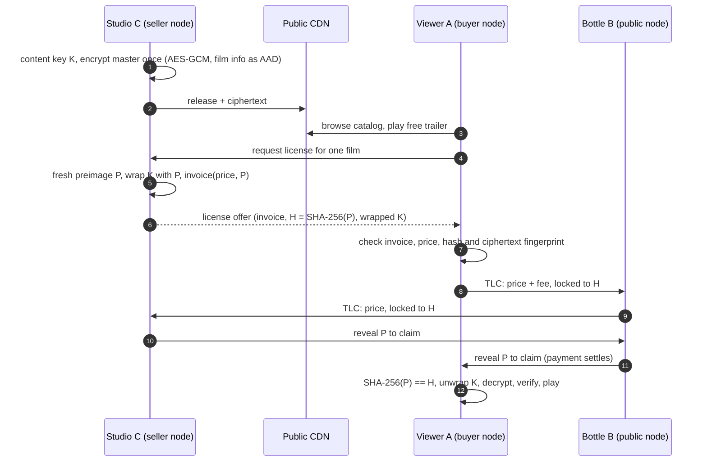

# CKB Cinema

Pay-per-view films over a Fiber payment on CKB Testnet. Watch the trailer for
free, then pay only for the film you want. There is no subscription and no
account, and no server ever holds the key: the Fiber payment itself reveals it.

Built for **Build on CKB Campaign #8, Quest 2 (Advanced)**, starting from the
starter project of the tutorial
[Unlock Encrypted Data with a Fiber Payment](https://www.fiber.world/docs/build/encrypted-data-payment)
(Fiber v0.10.1, `@fiber-pay/sdk` 0.3.1). **Testnet only.**

<!-- Demo recording: add docs/demo/ckb-cinema-demo.gif (or a video link) here. -->

One-page overview: [Litepaper](docs/LITEPAPER.md), also served by the app at `/litepaper`. Quest 1 (Basic) evidence and my reflection are in [docs/quest-1](docs/quest-1/README.md).

## The use case

Occasional viewers pay for a few films a year. A monthly subscription is a bad
deal for them, and card payments are too expensive for a 1 to 5 CKB rental.
CKB Cinema lets them preview a trailer and pay per title through a payment
channel, with the film key delivered atomically by the payment.

## How it works

The tutorial encrypts one result for one buyer. A film catalog needs more than
that: the film is large, many people buy it, and the file should sit on a CDN
once instead of being re-encrypted for every sale. CKB Cinema therefore uses
**envelope encryption**:

1. **Publish (once per film).** Studio C loads the master file from its own
   disk, checks it against the catalog's SHA-256 fingerprint, and encrypts it
   with a random 256-bit **content key** (AES-256-GCM). The public film
   description (id, title, type, size, film SHA-256) is the GCM *additional
   data*, so a relabelled file fails to decrypt. The ciphertext and a
   **release** record (fingerprints, IV, sizes) go to the public CDN. The
   content key stays in the studio.
2. **License (once per purchase).** When Viewer A clicks *Watch full film*, the
   studio generates a fresh 32-byte secret and uses it twice:
   - as the **payment preimage** of a Fiber invoice for the listed price, and
   - as the AES key that **wraps the content key**. The wrap's additional data
     binds film, film SHA-256, price and payment hash.

   The license offer (invoice, payment hash, wrapped key, last-hop hint) goes
   straight from studio to viewer. It is a few hundred bytes, whatever the
   film's size.
3. **Verify before paying.** Viewer A checks that the release matches the
   catalog fingerprint, that the invoice is on Fiber Testnet for exactly the
   listed price with the offer's payment hash, and that the downloaded
   ciphertext matches the release's SHA-256. *Try to play without paying*
   shows a guessed key being rejected.
4. **Pay.** Viewer A pays through Bottle B. To claim the payment, Studio C's
   node reveals the preimage, and Fiber returns it to Viewer A.
5. **Unlock and watch.** The viewer checks `SHA-256(preimage) == payment hash`,
   unwraps the content key, decrypts the film, checks the film's SHA-256, and
   plays it from memory.

Every purchase has its own payment hash, yet all of them open the same
encrypted file. The checkout shows this as "Encrypted once, licensed N times".



### Why Bottle B cannot keep the money

The checkout explains this with the real payment hash. Viewer A's payment to
Bottle is locked to the hash `H`. Bottle can claim it only by presenting the
preimage `P`, and it learns `P` only when Studio C claims Bottle's forwarded
payment. If the studio never reveals `P`, both locks expire and the funds
return. Bottle also sees `P`, but it never receives the license offer, which
goes directly from studio to viewer, so it cannot unwrap the film key.

## What I changed from the starter

| Area | Starter | CKB Cinema |
| --- | --- | --- |
| Use case | Encrypt one text result | Film catalog: free trailers, pay per title, in-browser playback |
| Encryption | One AES key per result, used as the preimage | **Envelope encryption**: film encrypted once with a content key; each purchase gets a new preimage that wraps that key (`lib/crypto.ts`) |
| Where the ciphertext lives | Inside the offer JSON | On a CDN as a separate file with a published **release** (`lib/vault.ts`, `lib/catalog.ts`); the offer stays small |
| Integrity | GCM tag on the result | GCM with film description as additional data; release, ciphertext and decrypted film are all checked by SHA-256; masters checked against catalog fingerprints |
| Offer format | `version: 2` | `version: 3`, `kind: "film-license"`, strict parser that drops unknown fields (`lib/offer.ts`) |
| Price | Fixed 1 CKB | Studio picks 1, 2, 3 or 5 CKB; the invoice must ask exactly the license price (`lib/payment.ts`) |
| Key check | Decrypt with the returned preimage | Also checks `SHA-256(preimage) == payment hash` before using it |
| Seller storage | None | Studio keeps content keys in IndexedDB so it can license again after a reload; the viewer only reads the public CDN store |
| Channel opening | `openChannel` right after `connectPeer` | Retries only fnn's "waiting for peer to send Init message" rejection, for up to 20 s (`lib/fiber.ts`) |
| Status | Manual refresh buttons | Polls every 5 s while funds, channels or the Bottle connection are pending; shows on-chain balance and channel balance bars |
| UI | Minimal form | A cinema front of house: a letterboxed feature screen that also plays trailers, poster listings with screen numbers, a paper ticket stub, a numbered ledger of every check, the Bottle B explainer, and the operator tools (nodes, prints) in a "Projection room" at the bottom. Fonts are self-hosted with `next/font` because the page is cross-origin isolated |
| Tests | 9 payment tests | 18: +1 price-mismatch test, +8 envelope, binding, tamper and release-parsing tests (`cinema.test.mjs`) |
| Media | None | Three short films, trailers, posters and wide stills, procedurally generated (`scripts/film-generator`), so there are no copyright issues |

These starter files keep their safety logic unchanged:
`lib/payment-submission.ts` (a payment is never resent while its outcome is
unknown), `lib/node-session.ts` and `lib/fiber-testnet-runtime.ts`.
`lib/progress.ts` only changes its session key. Payment attempts are still
recorded before submission, and a reload offers **Restore checkout** and
**Check payment status** instead of paying again.

## Run it

Node.js 22.18 or newer.

```sh
npm install
npm run dev            # http://localhost:3001
```

Use `localhost` or HTTPS. The Fiber WASM node needs a secure context,
SharedArrayBuffer and cross-origin isolation; `next.config.mjs` sends the
COOP/COEP headers. Avoid editing code while nodes run: a dev hot reload stops
them. Press **Start** again to resume with the same saved keys and channels.

All operator steps live in the **Projection room** at the bottom of the page.

1. **Network.** Start Viewer A and Studio C. Send Testnet CKB from the
   [faucet](https://faucet.nervos.org/) to each funding address (more than
   500 CKB each). The cards poll the balance. Then open both 500 CKB channels
   and wait for *Channel ready* (confirmation can take a few minutes).
2. **Publish.** For each film, choose its master from `samples/films/`
   (for example `samples/films/neon-tide.webm`), pick a price, and press
   **Encrypt & publish**. A wrong file is rejected by its fingerprint.
   You can also publish your own video (up to 40 MB).
3. **Browse.** Play a trailer for free on the feature screen.
4. **Buy.** Press **Buy a ticket**. Check the verified items, press
   **Try to play without paying** (rejected), then **Pay**.
5. **Watch.** Press **Unlock & watch**. Buy the same film again to see a
   second license with a different payment hash open the same encrypted file.

## Deploy

The app is a static Next.js page that needs the COOP/COEP headers on every
route. The production build has been checked to serve them:

```sh
npm run build && npm start
```

On **Vercel**, import the repository with the default Next.js settings. The
headers in `next.config.mjs` apply automatically. Any host works as long as it
sends `Cross-Origin-Opener-Policy: same-origin` and
`Cross-Origin-Embedder-Policy: require-corp`. The masters in `samples/films`
are not part of the deployed site; visitors load them from their own copy of
the repository.

## Checks

```sh
npm run typecheck
npm test               # 18 tests: payment safety + envelope crypto
npm run build
```

## Limitations

- **Demo, not DRM.** Once a viewer has the content key, they can share it or the
  decrypted file. Payment releases a key; it cannot stop copying.
- **Both roles in one browser.** The studio's content keys and the "CDN" live in
  this browser's IndexedDB, in separate stores. In production the studio would
  keep keys on its own machine and the CDN would be any static host. Viewer code
  reads only the CDN store.
- **The license offer must reach only the buyer.** Anyone holding both the offer
  and the revealed preimage can unwrap that license, which is why the offer is
  delivered directly and never through Bottle.
- **Re-encrypting a film** creates a new content key, so licenses issued earlier
  stop working.
- Invoices expire after one hour. Fiber Testnet and the faucet can be slow.
  Check an existing payment before trying again, and never clear browser storage
  for funded nodes.

## Credits

Starter project and Fiber tutorial by the Fiber team
([fiber.world](https://www.fiber.world/docs/build/encrypted-data-payment)).
Films, trailers and posters are procedurally generated by
`scripts/film-generator` for this demo.
