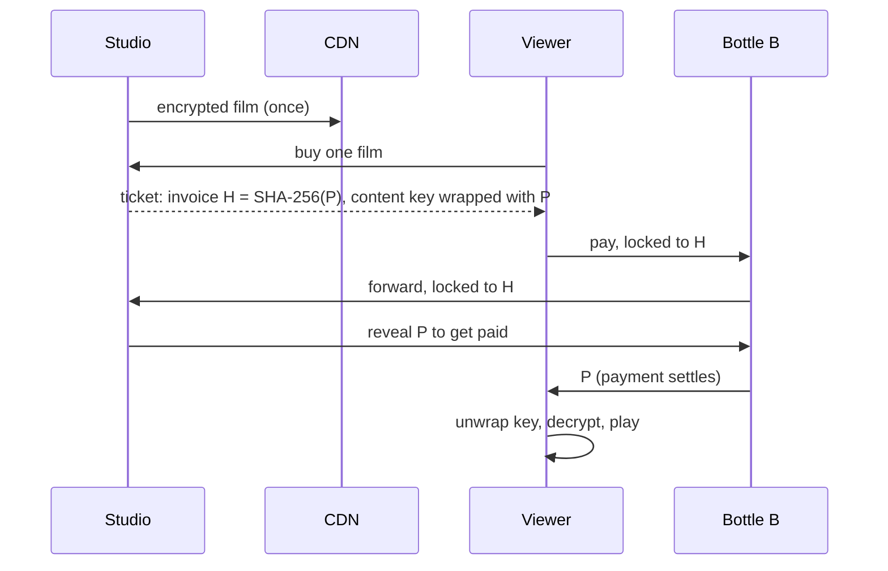

# CKB Cinema: pay per film, keyed by the payment

*Litepaper · Build on CKB Campaign #8 · CKB Testnet demo*

## Problem

People who watch a few films a year are badly served. A monthly subscription
charges them for months they don't use. Buying one title by card costs more in
fees and friction than a 1 to 5 CKB rental is worth. And every pay-then-receive
model asks the buyer to trust the seller to deliver after the money has gone.

## Idea

Watch the trailer for free. Pay for one film only. **The payment itself is the
key**: settling it is what hands the viewer the secret that unlocks the film,
so money and key change hands in the same step.

## How it works

1. **Encrypt once.** The studio encrypts each film with its own random content
   key (AES-256-GCM) and publishes the ciphertext on a public CDN, with a
   release record of fingerprints. Anyone can download it; nobody can watch it.
2. **Issue a ticket per purchase.** When a viewer buys, the studio creates a
   fresh 32-byte secret and uses it twice: as the **preimage of a Fiber
   invoice** for the film's price, and as the key that **wraps the content
   key**. The ticket (invoice, payment hash, wrapped key) is a few hundred bytes
   and goes straight to the viewer.
3. **Verify, then pay.** The viewer's browser checks the film against the
   catalog fingerprint, the invoice's network, amount and hash, and the
   downloaded ciphertext's hash. It then pays over Fiber (viewer → Bottle B →
   studio) in seconds, without an on-chain transaction.
4. **Unlock.** To be paid, the studio's node must reveal the preimage, and Fiber
   returns it to the viewer. The browser checks `SHA-256(preimage) = payment
   hash`, unwraps the content key, decrypts the film, checks its fingerprint and
   plays it from memory.

## Why it can be trusted

- **The studio** cannot take the money without revealing the key: claiming the
  payment *is* revealing it.
- **The viewer** cannot get the key without paying: the wrapped key opens only
  with the preimage, which only a settled payment reveals.
- **Bottle B**, the routing node, cannot keep the money: its incoming payment is
  locked to the same hash, so it is paid only after the studio reveals the
  secret. If the secret never appears, both locks expire and the viewer is
  refunded. Bottle never sees the ticket, so the secret alone opens nothing.

## Why envelope encryption

A per-buyer key would mean re-encrypting and re-uploading a whole film for
every sale. Here a film is encrypted once and sold many times; each sale only
adds a ticket with its own payment hash. Every ticket is bound to its film,
price and payment hash, so it cannot be reused for another film or another
price.

## What the demo shows

A working Next.js app on CKB Testnet, built from the Fiber starter: two browser
Fiber nodes, three generated short films with free trailers, tickets at 1 to 5
CKB, a checkout that lists every check, and a second purchase of the same film
opening the same encrypted file with a different payment hash.

## Limits

- **Not DRM.** A viewer who has paid can share the key or the decrypted film.
  Payment guarantees delivery of the key, not protection against copying.
- **One browser, both roles.** In production the studio runs its own node and
  keeps content keys off the viewer's machine.
- **Testnet only.** Liquidity, invoice expiry (one hour) and routing fees follow
  Fiber Testnet today.

## Next steps

Studio-side server for keys and ticket issuing; streaming decryption in chunks
for full-length films; previews and reviews so buyers can judge a film before
paying; stablecoin pricing over Fiber.
