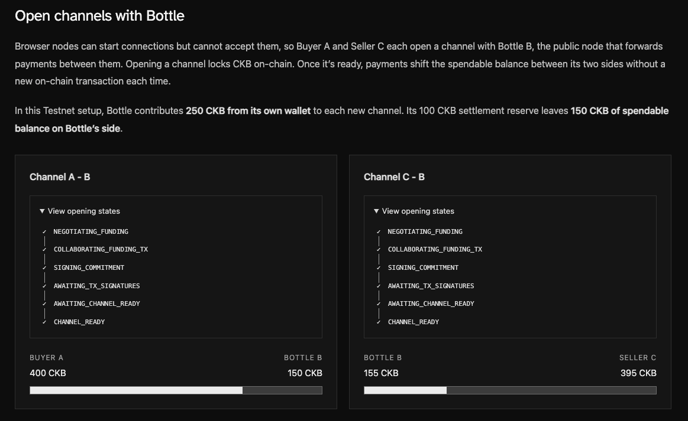
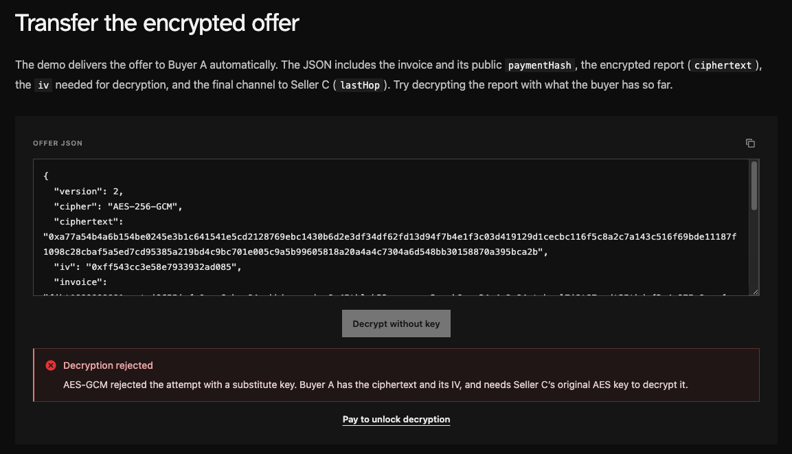
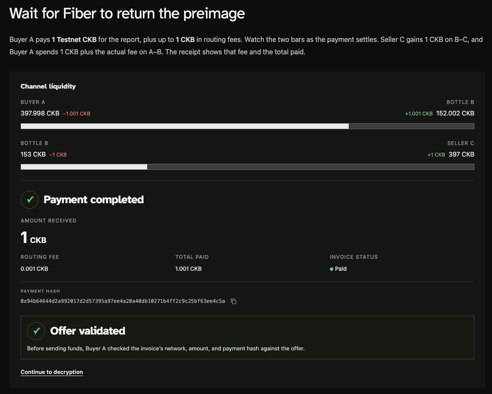
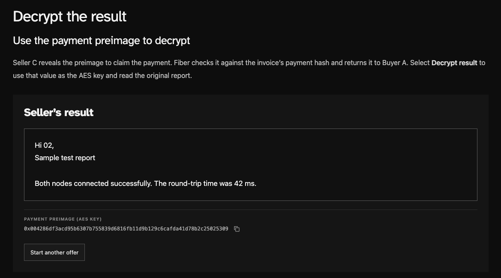

# Quest 1 (Basic): Pay to unlock a report

Completed with the interactive tutorial [Unlock Encrypted Data with a Fiber Payment](https://www.fiber.world/docs/build/encrypted-data-payment) on CKB Testnet.

## Evidence

| Step | Screenshot |
| --- | --- |
| Setup: both channels reach `CHANNEL_READY` | [01-setup-both-channels-channel-ready.png](01-setup-both-channels-channel-ready.png) |
| Before payment: encrypted offer on the buyer side, **Decryption rejected** | [02-before-payment-encrypted-offer-decryption-rejected.png](02-before-payment-encrypted-offer-decryption-rejected.png) |
| After payment: receipt for **1 CKB** with its payment hash | [03-after-payment-receipt-1ckb-payment-hash.png](03-after-payment-receipt-1ckb-payment-hash.png) |
| After decryption: result matches the seller's sample text | [04-after-decryption-result-matches-original.png](04-after-decryption-result-matches-original.png) |

Screenshots 02 to 04 come from the same offer. The receipt's payment hash is
`0x94b64644d2a992017d2d57395a97ee4a20a40db10271b4ff2c9c25bf63ee4c5a`, and the
SHA-256 of the preimage shown in screenshot 04
(`0x004286df3acd95b6307b755839d6816fb11d9b129c6cafda41d78b2c25025309`) equals it.

## Reflection

**How did it feel to have the explanations alongside each interactive step?**
This was my first interactive Fiber tutorial. Before this I had only read the docs. Having the explanation right beside each interactive step made it easy to follow, and it connected what I had read in the docs to what actually happens, such as the channel opening stages leading up to `CHANNEL_READY`. I understood why I was doing each step instead of just clicking through.

**What surprised you or stood out about paying to unlock the report?**
The payment preimage is the AES key itself. The seller uses that key as the invoice preimage, so the buyer only gets the key once the payment completes. I saw this directly: "Decrypt without key" was rejected, and after paying 1 CKB I could decrypt the original report.

**Was there a step where you were unsure what to do next or why it mattered?**
No. Every step was clear, helped by the explanations and by the Fiber background I had from the docs.

**If you ran into a problem, what did you expect, what happened, and how did you resolve it?**
I did not run into any problems while doing the tutorial.

**What would you like to build using this pay-to-unlock flow?**
An online movie platform where viewers can watch a trailer for free and pay to unlock the full movie, paying only for that specific title. It would suit people who watch few movies, for whom pay-as-you-go makes more sense than a subscription.

**If you could change one thing about the tutorial, what would it be?**
I would extend the demo to explain why Bottle B can act as an intermediary without being able to take the payer's funds.

The Advanced quest in this repository builds the movie idea above, and its checkout includes that Bottle B explanation.
