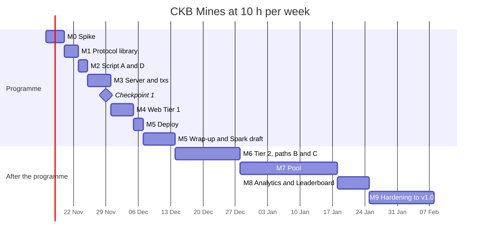

# Development plan: CKB Mines

**Status:** draft, 2026-11-14. Replaces the week table in [SPEC](SPEC.md) section 9 as the working schedule. CKB testnet only.
**Budget assumption:** 10 h/week, AI-assisted, continuing after the CKBuilders programme ends. **[ASSUMPTION: confirm the post-programme budget.]**
All hours below are my estimates, not measurements.

## 1. What "done" means

| Level | Scope | Target date |
|---|---|---|
| **Programme deliverable** | Tier 1: script paths A and D, Play and Verify (off-chain checks), placeholder tabs, public testnet link, video, Spark draft | Week 12, 2026-12-13 |
| **Phase 1 complete** | Tier 2: paths B and C on testnet, "server killed" drill, Verify reads the chain | 2026-12-27 |
| **Phase 2 complete** | Pool, Analytics, Leaderboard | 2027-01-24 |
| **v1.0** | Hardening: last-look fix, external script review, concurrency test, operations | 2027-02-07 |

Out of scope at every level: mainnet and anything with real value.

## 2. Where things stand (2026-11-14, end of day)

Phase 1 (paths A–D, Play, Verify, placeholder tabs) was built in one push on 2026-11-14, well ahead of the schedule in section 6. The milestones below are kept as the original plan; this section is the current truth.

- **Done and verified:**
  - M0 spike: the worst-case paths fit ckb-js-vm (bytecode about 20M cycles, JS source about 57M), so the script stays in TypeScript. CCC co-signing works for private-key signers.
  - M1 `packages/protocol`, M2 + M6 `packages/script` with all four paths, deployed to testnet (see README).
  - M3 `apps/server` (Fastify + Postgres) and `packages/chain` (tx builders, `MinesPlayer` SDK).
  - M4 `apps/web`: Play on the real chain, Verify reading the bet cell from chain, Pool / Analytics / Leaderboard placeholders.
  - Reliability: see section 2.1.
- **Not done:**
  - JoyID co-signing has not been tried. It needs a human with a passkey; the dev-key signer covers local testing.
  - Public deployment (M5), video, Spark draft.
  - Neon and DevRel review. **[Status unknown: fill in.]**
- **Sessions (ADR 0001), done the same day:** deposit once, rounds off-chain in about 35 ms each, withdraw in one transaction, or close and collect without the operator. Lock `mines-session` deployed to testnet; it is the default Play tab, and single games moved to a "Single game" tab. Results in section 2.2. See [ADR 0001](docs/adr/0001-multi-round-sessions.md).
- **Consequence:** Tier 2 no longer moves after the programme. Weeks 9–12 can go to JoyID, deployment, hardening (M9 items) and the wrap-up.

### 2.1 Reliability results

Target: at least 95% of real testnet games settle with the right amounts, and 100% of unit and mock tests pass.

Measured on 2026-11-14, server with `T_PLAY=90 D_EXIT=240 D_FORFEIT=900`. Raw results in `e2e-results/` (local, gitignored).

| Run | Games | OK | Cash-out | Loss | Solo exit |
|---|---|---|---|---|---|
| E2E batch 1 (before the fix below) | 8 | 3 | 0/0 | 3/3 | 0/0, 5 failed to open |
| E2E batch 2 | 12 | 12 | 2/2 | 6/6 | 4/4 |
| E2E batch 3 | 40 | 40 | 18/18 | 16/16 | 6/6 |
| E2E batch 4 | 20 | 20 | 5/5 | 10/10 | 5/5 |
| **After the fix** | **72** | **72 (100%)** | 25/25 | 32/32 | 15/15 |

- **What counts as OK:** the game settles on chain, the player's net flow equals the rules exactly (to the shannon), the server records the same outcome and transaction, and the five Verify checks pass with the published seed.
- **Statistical reading:** 72 successes in a row bound the true failure rate below 4.2% at 95% confidence (rule of three), so the success rate is at least 95.8%.
- **Batch 1 failures, fixed:** a freshly funded player's CCC cache kept offering a cell the server had already spent in the player's bet transaction. `MinesPlayer` now marks every transaction it signs but the server broadcasts (bet, cash-out) in its own cache.
- **Drills, both passed:**
  - Path D forfeit: the player went silent; the server reclaimed exactly the bet minus the 0.001 CKB fee.
  - Server killed: the player exited alone through path C with the exact amount while the server was down. After the restart, the server recorded the same exit transaction.
- **Web app, by hand in the browser with the dev key:** one cash-out and one solo exit with the server stopped. Both show FAIR (5/5) on Verify, which reads the bet terms and the payout from the chain.
- **Unit and mock tests:** 63/63 pass (protocol 19, script 31, chain 9, server 4).
- **Not covered:** JoyID and other real wallets; concurrency beyond 4 players; the default production timelocks (only short test values were run).

### 2.2 Session results

Measured on 2026-11-14 with `D_CHALLENGE=120` (production default is 24 h). Raw results in `e2e-results/session-*.json` (local, gitignored).

A session counts as OK when it pays out on chain, the player receives exactly the balance its rounds add up to (computed by the E2E script, independently of the SDK), and the server records the same close and amount.

| Run | Sessions opened | OK | Coop withdraw | Close alone mid-round | Rounds |
|---|---|---|---|---|---|
| Smoke tests | 2 | 2 | 1 | 1 | 7 |
| Batches 1–2 (before the house-cell fixes) | 5 | 5 | 2 | 3 | 26 |
| Batch 3 | 12 | 12 | 8 | 4 | 63 |
| Batch 4 (stopped to fix a reservation leak) | 5 | 5 | 5 | 0 | 25 |
| Batch 5 | 36 | 36 | 25 | 11 | 183 |
| **Total** | **60** | **60 (100%)** | 41 | 19 | 304 |

- **Speed:** a round (start, reveals, bank) took 36 ms median and 60 ms p95 against the local server. A deposit takes one block (about 30–50 s); a cooperative withdrawal one block.
- **Statistical reading:** 60 successes in a row bound the failure rate below 5% at 95% confidence (rule of three).
- **Refused, not failed:** 16 sessions were refused at open with HTTP 503 (no house cell free) and moved no money. Two causes, both fixed: each deposit consumed one large house cell, so the pool fragmented into cells too small for a session (deposits now merge house cells); and a reservation for a cell the node did not yet report live was kept for 3 hours, which locked live cells (now dropped at once).
- **Harness bugs found by the first smoke test, fixed:** the client could ask for a round before the operator had seen the deposit; the script picked a difficulty the operator deposit no longer covered. Both sessions left open were later closed by the operator's idle timeout with exact amounts (150 and 174.7 CKB).
- **Drills:**
  - `loss`, passed: the player hit a mine, refused to sign, closed on the round state and posted a receipt. The operator posted the loss proof; the player got exactly its 130 CKB balance outside the round.
  - `stale-player`, passed: the player posted its opening state (150 CKB) after losing to 140. The operator posted the later state about 40 s later; the payout was exactly 140 CKB.
  - Idle close, passed three times (two harness leftovers, one unsigned loss): the operator closed alone after `SESSION_IDLE`, posted the loss proof where it had one, and settled with exact amounts.
  - **Not run:** `stale-house` (the player's browser must defend while the operator is down) and `killed` (operator stopped mid-round). Both need the server stopped by hand. The player-side code paths they exercise (`defend()` posting UPDATE, RECEIPTS and SETTLE) did run in the 19 close-alone sessions above.
- **Web app, by hand with the dev key:** opened a 150 CKB session (one signature), lost one round and banked one (balance updated instantly, 5/5 checks in the browser), withdrew 142.71 CKB in one transaction.
- **Unit and mock tests:** 116/116 pass (protocol 28, script 62, chain 22, server 4).
- **Not covered:** JoyID; production `D_CHALLENGE`; more than 3 concurrent E2E players; the two drills above.

## 3. Constraints that set the order

1. **Paths B and C ship together, never C alone.**
   - Without B, a player who hits a mine can stop talking to the operator and wait for `D_exit`.
   - They can then exit through C with the receipts they earned before the mine, and get paid for a lost game.
   - B lets the operator settle the loss first, which closes that gap.
2. **Tier 1 is an honest-operator escrow.**
   - With only A and D, the operator can refuse to co-sign a win and reclaim the bet through D after `D_forfeit`.
   - The UI and the README must say this plainly.
3. **Tier 1 losses settle through A.**
   - The player's client co-signs the loss.
   - If a player refuses, the collateral stays locked until `D_forfeit`. See decision D1.
4. **One protocol library, three runtimes.**
   - It has to run unchanged in ckb-js-vm (QuickJS), Node and the browser.
   - That means no Node APIs, amounts as `BigInt` shannons, and the hash function injected by the caller.
   - One golden-vector file is checked by all three test suites.
5. **Spike before script code.** The cycle numbers decide between TypeScript and Rust for the whole script.

## 4. Repository layout

```text
my-project/
├── SPEC.md, PLAN.md, README.md
├── packages/protocol   shuffle, leaves, Merkle, payout, encoding, golden vectors
├── packages/script     mines-lock and mines-session on ckb-js-vm (scaffolding copied from week-05/project)
├── packages/chain      CCC tx builders for paths A–D and sessions, MinesPlayer and SessionPlayer SDKs, deployment records
├── apps/server         Node/TypeScript game server + Postgres
└── apps/web            Next.js + CCC, port of the Receipt prototype
```

npm workspaces. `packages/protocol` is shared by all runtimes; `packages/chain` by the server, the web app and the test scripts. If the project goes to Spark, it moves to its own repository (decision D2).

## 5. Milestones

### M0 Spike: 6 h, Week 9 (start this weekend if hours are left in Week 8)

1. **Cycles (3 h):**
   - Write the worst cases in ckb-js-vm:
     - path B: layout rebuild, mine count, π shuffle, `Q` proof
     - path C: 7 receipts
   - Run them in ckb-testtool and record the cycles.
2. **Co-signing (2 h):**
   - Build a CCC transaction with one player input and one operator input.
   - The player signs in the browser (JoyID first, private-key signer as fallback), then the server adds its signature and broadcasts.
3. **Facts (1 h):**
   - occupied capacity of the bet cell with real args
   - relative `since` behaviour, using a 2-minute delay on testnet
   - faucet limits

**Done when:** `spike/NOTES.md` has the cycle numbers, the capacity number, the faucet limits, and one testnet tx hash signed by two parties.

**Gate G0:**
- Cycles fit: write the script in TypeScript.
- Cycles do not fit: write the whole script in Rust (paths A and D are trivial in either language).
- JoyID cannot co-sign: use a private-key or Omnilock demo wallet.

### M1 Protocol library: 4 h, Week 9

**Tasks:**
- seed → layout
- π shuffle
- leaves, 16-leaf Merkle tree and proofs
- payout in `BigInt` shannons
- fixed-layout encoding of the script args and witnesses
- golden vectors, including the SPEC example and the 25 CKB rounding case

**Done when:** the unit tests pass in Node, and the same vectors pass inside ckb-js-vm in the M2 script test.

### M2 Script, Tier 1 (paths A, D): 3 h, Week 10

**Done when:**
- The mock suite shows:
  - A passes with both lock inputs present.
  - A fails if either one is missing.
  - D fails before `D_forfeit` and passes after it.
- The script is deployed on testnet with Type ID, as in Week 5.

### M3 Server and transactions: 7 h, Week 10

**Tasks:**
- Endpoints:
  - `start` returns `R`
  - `commit` receives `C` and `Q`
  - co-signing the bet
  - `reveal` returns a receipt
  - `cashout` (path A)
  - `loss` (path A, Tier 1)
- Postgres tables: bets, reveals, transactions.
- Pool shards: N = 3 to start, plus the sponsor fee input.

**Done when:** a CLI plays one bet on testnet (open, two receipts, cash out) and prints the tx hashes.

**Checkpoint 1, end of Week 10 (2026-11-29):** a bet is opened and settled cooperatively on testnet.
- If not, freeze the programme scope at "escrow + Verify" and spend Week 11 only on making that usable.

### M4 Web, Tier 1: 7 h, Week 11

**Tasks:**
- CCC wallet connect.
- Port the Receipt direction from the prototype: Play, and Verify with off-chain checks from the protocol library.
- Pool, Analytics and Leaderboard tabs with "Coming soon".
- Amounts from shannons, shown with two decimals.
- Tier 1 trust notice.

**Done when:** a second person plays a bet from their own browser on testnet.

### M5 Deploy and programme wrap-up: 3 h in Week 11, 10 h in Week 12

**Tasks:**
- Hosting: Vercel for the web, one small AWS instance for the server and Postgres, keys in environment config, basic logs.
- Cohort play-test and metrics: distinct players and settled games, from SPEC section 14.
- Demo video (2–3 minutes).
- README with the cell design.
- Week 12 report and retrospective.
- **Spark proposal draft whose scope is M6–M9.**

**Done when:** the public link, video and metrics table exist.

---

*After the programme*

### M6 Tier 2 (paths B + C): 20 h, Weeks 13–14

**Tasks:**
- **Script: paths B and C, with attack tests that must all fail:**
  - rigged layout
  - extra mines
  - loss on a safe tile
  - loss on a tile the player never picked
  - forged receipt
  - duplicate receipts
  - exit before `D_exit`
  - payout below the net-flow minimum
- **Server:**
  - broadcast the loss tx before replying
  - enforce `T_play`
- **Web:**
  - store receipts locally, with export
  - build the path C exit from the stored receipts
  - Verify reads the bet cell and the settlement from the chain
- **Drill:** kill the server mid-game, then exit with receipts. Record it.

**Done when:** every attack test fails as expected, each path has at least one testnet tx, and the drill is recorded.

### M7 Pool: 25 h, Weeks 15–17

1. **Economics and design spike (3 h):**
   - The operator earns about 0.02–0.14% of the locked collateral per bet (SPEC section 3).
   - Decide whether liquidity-provider (LP) shares are worth building.
   - Decide how pool value is computed across shards: one state cell (contention) or summing shards in each transaction (bigger transactions).
2. **Share token:** reuse xUDT with the pool script as owner, not a custom token.
3. **Pool type script:** deposit and withdraw at pool value, with withdrawals limited to collateral not locked by open bets.
4. **Web:** Pool tab.

**Gate G2, after step 1:** if the LP return is not worth it, ship a **transparent house pool** instead (8 h): public balances, locked collateral and P&L, no share tokens.

### M8 Analytics and Leaderboard: 10 h, Week 18

**Tasks:**
- An indexer job reads settled bets from chain into Postgres and cross-checks them with the server database.
- Analytics: games per day, volume, realised against theoretical edge, pool utilisation.
- Leaderboard: top payouts and longest streaks, each row linking to Verify.

**Done when:** the numbers on the page match a recount from chain data.

### M9 Hardening to v1.0: 15 h, Weeks 19–20

**Tasks:**
- **Last-look fix:** the player creates the bet alone from a pre-funded operator offer cell. Design first; this may need its own milestone.
- **External review** of the script by DevRel or the community.
- **Concurrency test:** N parallel bets on the shards, with contention measured.
- **Operations:**
  - operator key handling
  - database backup
  - after a restart, the server picks up the bets that were still open
  - alert on open bets close to `D_exit`
- **Mobile and accessibility pass.**

## 6. Timeline



| | Hours |
|---|---|
| Programme (M0–M5) | 40 |
| After the programme (M6–M9) | 70 |
| **Total** | **110** |

The holiday weeks (M6, M7) are the most likely to slip.

## 7. Cut lines, in order

If behind, cut from the top:

1. JoyID → private-key demo wallet.
2. Verify reads the chain → Verify uses server data plus the protocol library.
3. Pool shards N = 3 → N = 1 (one bet per block).
4. LP shares → transparent house pool.
5. Analytics → Leaderboard only.

Never cut: paths B and C shipping together (section 3.1), the Tier 1 trust notice, or the attack tests.

## 8. Open decisions

| # | Decision | Proposal |
|---|---|---|
| D1 | `D_forfeit` on testnet while only Tier 1 exists | 1 h instead of 24 h, so refused losses do not lock collateral for a day |
| D2 | Where the code lives | Stay in `ckbuilder/my-project` during the programme; own repository when Spark starts |
| D3 | Budget after the programme | 10 h/week (assumption) |
| D4 | Neon and DevRel answers to SPEC section 13, questions 1 and 4 | Can change M0 and G0; get them before M2 |
