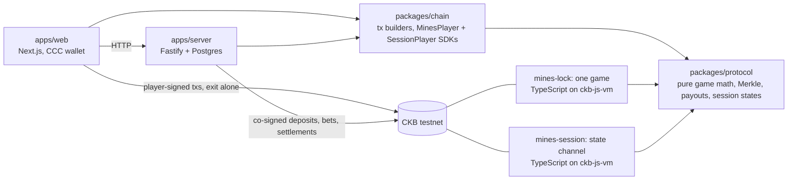

# CKB Mines

A 3×3 mines game on **CKB testnet** where the operator cannot rig the board or keep a player's winnings.
Testnet only. Tokens have no value. Design: [SPEC.md](SPEC.md). Schedule and status: [PLAN.md](PLAN.md).



| Package | What it is |
|---|---|
| `packages/protocol` | Pure TypeScript: layout, Merkle receipts, payouts, args/witness encoding, the five Verify checks, and the session rules (`session.ts`, `checkSession`). No dependencies; the hash is injected. |
| `packages/script` | Two locks for ckb-js-vm: `mines-lock` (one bet cell, paths A–D) and `mines-session` (a session cell, ADR 0001). Tested with ckb-testtool. |
| `packages/chain` | CCC transaction builders for every path and every session transition, plus the player-side SDKs `MinesPlayer` (one game) and `SessionPlayer` (sessions), used by the web app and the E2E harness. |
| `apps/server` | Operator: seals layouts, co-signs bets and cash-outs, settles losses (path B), forfeits (path D); opens sessions, signs round states, and defends sessions on chain. |
| `apps/web` | Play (sessions, the default), Single game, Verify, and placeholder Pool / Analytics / Leaderboard tabs. |

## Settlement paths

| Path | Who sends it | When | Money |
|---|---|---|---|
| A cash-out | player + operator | any time after ≥1 safe tile | player gets `payout(stake, k, m)`, operator pays the fee |
| B loss | operator alone | the player picked a mine | operator proves the mine from seed S and takes the bet |
| C exit | player alone | after `D_exit`, with the receipts held in the browser | player gets at least the payout for its receipts and pays the fee |
| D forfeit | operator alone | after `D_forfeit` | operator reclaims a bet nobody settled |

Deployed lock (testnet): code hash `0x61099b4eaf55abe66cb28d19a919e79cc89e4e29b101dfcd7dac8aab5126db11` (type), see `packages/chain/src/mines-lock.testnet.json`.

## Sessions (the default Play tab)

Design and threat model: [ADR 0001](docs/adr/0001-multi-round-sessions.md). In short:

1. **Deposit once.** The player's wallet signs one transaction that locks the player deposit and an operator deposit (125 × the chosen max bet) in a session cell.
2. **Rounds are off-chain.** Each round is a state signed by both sides: the player with a session key generated in the browser (no popup), the operator with its key. A round starts, reveals tiles and banks a win in tens of milliseconds.
3. **Withdraw when you want.** Both sign a final state and one transaction pays both sides.
4. **Without the operator.** The player posts its latest co-signed state (`CLOSE`), then its receipts for an unfinished round. After `D_challenge` anyone can `SETTLE`. A stale state is answered with a later one (`UPDATE`); a loss is proven with the seed (`LOSS`). Payouts always go to the wallet lock in the session args.

Deployed lock (testnet): code hash `0xded4d77aa3f167ede81fb645e01a0f28aa37533557a2aa98fd4549e6d98ce11c` (type), see `packages/chain/src/mines-session.testnet.json`.

## Run it locally

Requirements: Node 22, Docker, a funded **testnet** key.

1. Install the packages and start Postgres.
   ```bash
   npm install
   ```
   ```bash
   docker compose up -d
   ```
2. Put the operator key in `my-project/.env` (gitignored). Testnet only.
   ```
   PRIVATE_KEY=0x...
   ```
3. One time: split the operator balance into house cells, so several bets can run at once.
   ```bash
   npm run house:split --workspace apps/server
   ```
4. Start the server. Defaults: `T_PLAY=600 D_EXIT=900 D_FORFEIT=86400` seconds. For quick tests, shorten them:
   ```bash
   cd apps/server && T_PLAY=90 D_EXIT=240 D_FORFEIT=900 npm start
   ```
5. Start the web app at http://localhost:3000. It talks to `NEXT_PUBLIC_API` (default `http://localhost:8787`).
   ```bash
   npm run dev --workspace apps/web
   ```
6. Optional: a throwaway dev wallet for self-testing without JoyID. This writes `NEXT_PUBLIC_DEV_PRIVATE_KEY` to `apps/web/.env.local` and funds it with 400 CKB from the operator. Restart `next dev` afterwards; a **Use dev key** button appears. It only works under `next dev`.
   ```bash
   cd apps/server && npx tsx scripts/dev-wallet.ts
   ```

Session settings (env): `D_CHALLENGE` (86400 s; use about 120 for tests), `SESSION_IDLE` (1800 s, after which the operator closes an idle session on its own), `MIN_DEPOSIT_CKB` (100), `MAX_DEPOSIT_CKB` (2000), `MAX_SESSION_HOUSE_CKB` (2500, which caps the max bet at 20 CKB). Each open session holds one house cell of 125 × max bet + 61 CKB, so split the operator balance into enough cells for the sessions you expect at once.

Other server settings (env): `PORT`, `DATABASE_URL`, `CKB_RPC_URL`, `CORS_ORIGIN`, `MAX_COLLATERAL_CKB` (2500), `MIN_STAKE_CKB` (10), `COMMIT_TIMEOUT`, `WATCH_INTERVAL_MS`.

## Tests

Unit and mock tests (protocol, lock script under ckb-testtool, tx builders, server settlement guard):
```bash
npm test
```

End-to-end on testnet. Throwaway players are funded from the operator, their keys go to `.e2e-keys.json` (gitignored). They play real games along every path. A game counts as a success only if it settles on chain, the player receives exactly what the rules say, the server records the same outcome, and the five Verify checks pass. Results go to `e2e-results/`.
```bash
cd apps/server && npx tsx scripts/e2e.ts --games 40 --players 4 --exit-share 0.25
```

Failure drills on testnet:
- `--mode forfeit`: the player goes silent and the operator must reclaim the bet through path D.
- `--mode killed`: the script asks you to stop the server mid-game. The player exits alone through path C, and once you restart the server it must record that exit.
```bash
cd apps/server && npx tsx scripts/drill.ts --mode forfeit
```
```bash
cd apps/server && npx tsx scripts/drill.ts --mode killed
```

Sessions end-to-end (server with `D_CHALLENGE=120`). `coop` sessions play rounds and withdraw; `alone` sessions close without the operator in the middle of a round, post their receipts and collect after the window. A session counts as a success only if the player receives exactly the balance the rounds add up to (computed by the script, independently of the SDK) and the server records the same close and amount.
```bash
cd apps/server && npx tsx scripts/session-e2e.ts --sessions 12 --players 3 --rounds 5 --alone-share 0.35
```

Session drills: `stale-player` (the player posts an old state where it had more), `stale-house` (an old state where the operator had more, with the server stopped so the player's browser must defend), `loss` (the player hits a mine, refuses to sign and closes with receipts), `killed` (the server is stopped mid-round).
```bash
cd apps/server && npx tsx scripts/session-drill.ts --mode loss
```

Results so far: [PLAN.md](PLAN.md) sections 2.1 (single games) and 2.2 (sessions).

## What the player keeps

The browser stores the player seed C, the nine pick secrets, and every receipt in `localStorage`. These are what allow an exit without the operator (path C) and a full Verify later. Clearing site data before a game settles loses them: the player can no longer exit alone or verify the picks.

A session adds the session private key and the latest state both sides signed. The session key can only sign states; payouts always go to the wallet lock. Losing them means the player cannot answer a stale close or close alone, so the Play tab offers a downloadable session backup.
