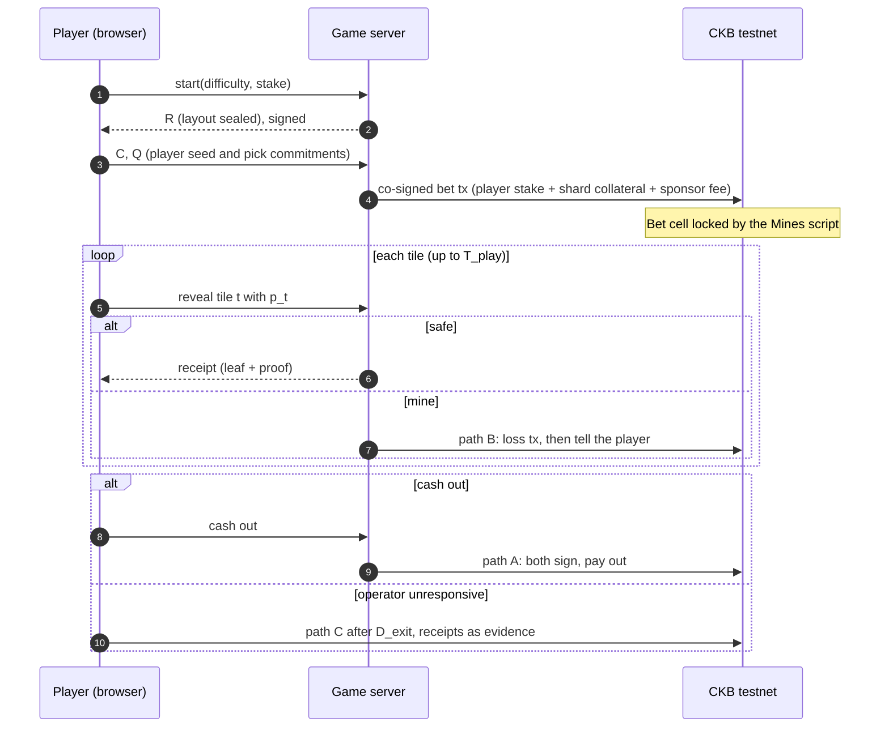
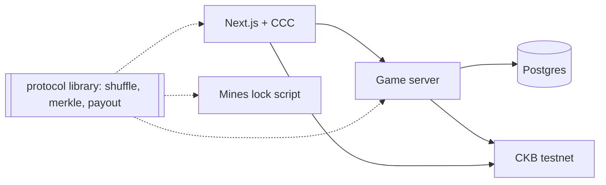

# SPEC: CKB Mines (working title)

**Status:** DRAFT for the Week 7 discussion with Neon and CKB DevRel. Not yet reviewed by them.
**Author:** Trinh Bach · **Track:** CKBuilders · **Spec date:** 2026-11-08
**MVP window:** Weeks 8–11 (4 weeks), **CKB testnet only, tokens have no value.**

> Items marked **[VERIFY]** are assumptions I have not confirmed against docs, code, or a live node. They are collected in section 12 and must be resolved by the Week 8 spike. All numbers in sections 3, 7 and 9 are my estimates, not measurements.

## 1. Problem and users

Mines is a simple, familiar game: a 3×3 grid hides some mines; the player reveals tiles, each safe tile raises the payout multiplier, and the player may cash out at any time or lose the stake by hitting a mine.

Existing implementations of this game are custodial and the player has to trust the operator twice: that the layout was not rigged, and that a win will actually be paid. The design question for CKB is: **how much of that trust can a cell and a script remove, without putting every click on-chain?**

- Clicking tiles must be instant, so tile reveals happen off-chain.
- Money must be held by a script, not by the operator's database: the stake and the operator's matching collateral sit in one cell from the first click.
- If the operator disappears mid-game, the player must still be able to take the winnings earned so far, using only evidence the operator already gave them.

**First users:** the CKBuilders cohort (about 60 developers), playing with faucet testnet CKB. Testnet faucets make onboarding free. **[VERIFY with Neon: faucet limits and whether cohort members will play-test.]**

**Not users in the MVP:** anyone who needs mainnet, real money, or a non-CKB asset.

## 2. Why CKB (criterion a, with honest limits)

| CKB feature | Used for | Strength of the reason |
|---|---|---|
| Cell with a custom lock script | Dual-funded escrow: player stake and operator collateral locked together; payout enforced by the script, not by a database | Real: the guarantee that a win is payable exists from the first click |
| `since` timelocks | Unilateral exit paths when one side disappears, with no keeper bot | Real, and native to CKB |
| Cell model concurrency | The pool is split into several shard cells so many bets can run in the same block (one shared pool cell would let only one transaction consume it per block) | Real, a CKB-specific design constraint |
| Sponsored fees | Operator adds a fee-paying input, so a player needs no extra balance for fees | Moderate |
| Hash and Merkle commitments checked by the script | Fairness evidence the chain can verify, without signature verification inside the script | Real, but the logic itself is chain-agnostic |

**Weakest points, stated plainly:**

1. The operator is still trusted for **liveness** (it can stop answering) and for **last look** (see section 4.5). The script limits the damage but does not remove the operator.
2. The game logic is chain-agnostic; CKB contributes the escrow, timelocks and concurrency model. Neon/DevRel should challenge whether that is enough for criterion (a).
3. Demand for wagering-style games on CKB is unproven (the Opportunity Map lists cross-operator games as frontier). **[VERIFY the wording against the map.]**

## 3. Game rules

- Grid: 9 tiles. Difficulty sets the number of mines `m`: Easy 2, Medium 3, Hard 4.
- The player picks a stake and a difficulty, then reveals tiles one by one. After `k` safe tiles the multiplier is `M(k, m) = C(9,k) / C(9−m, k)` (fair odds, no edge in the multiplier itself).
- The player may cash out after any number of safe reveals (`k ≥ 1`). Revealing all `9−m` safe tiles cashes out automatically.
- Hitting a mine loses the stake.
- **Fee:** 5% of the profit on a winning cash-out. Nothing extra on a loss.

**Payout formula (integers, in shannons; rounding always against the player):**

```text
gross  = floor(stake × C(9,k) / C(9−m,k))
profit = gross − stake
fee    = ceil(profit × 5 / 100)
payout = gross − fee
```

**Multipliers (fair, before the fee):**

| Safe tiles `k` | Easy (2 mines) | Medium (3 mines) | Hard (4 mines) |
|---|---|---|---|
| 1 | 1.29× | 1.5× | 1.8× |
| 2 | 1.71× | 2.4× | 3.6× |
| 3 | 2.4× | 4.2× | 8.4× |
| 4 | 3.6× | 8.4× | 25.2× |
| 5 | 6× | 21× | 126× |
| 6 | 12× | 84× | — |
| 7 | 36× | — | — |

Example: stake 100 CKB, Easy, 3 safe tiles: gross 240, profit 140, fee 7, payout 233.

**House edge:** because the fee applies only to profit, the player's expected return at multiplier `M` is `0.95 + 0.05/M`, so the edge is `5% × (1 − 1/M)`: about 1.1% at 1.29× and approaching 5% at the top multipliers. Early cash-outs are cheap for the player; the operator earns mostly from deep runs. This matters for the LP economics in phase 2.

**What this means for play and for the operator** (my calculation from the formulas above, recomputed in integer shannons; not measured):

- The multiplier is fair, so `P(survive k tiles) × M(k) = 1` for every `k`. Before the fee, every cash-out rule has the same expected return. Difficulty and cash-out point change only the variance, a player cannot beat the game by choosing when to stop, and the operator earns only through the fee.
- The operator's return on locked collateral is small. Collateral is `(C(9,m) − 1) × stake` and the expected fee is below 5% of the stake, so the fee earned per bet is about 0.03–0.14% of the collateral on Easy, 0.02–0.06% on Medium and 0.02–0.04% on Hard (lowest at the first tile, highest at the deepest run). This is per bet, not annualised, and it ignores variance. The phase-2 LP return model starts from this number.

**Bet limits (proposal, tune after the faucet check):**

- Operator collateral per bet is `(C(9,m) − 1) × stake`, i.e. 35×, 83× or 125× the stake on Easy, Medium, Hard.
- `maxCollateral` = 2,500 testnet CKB per bet, so maximum stake is about 71 / 30 / 20 CKB. Minimum stake 10 CKB. **[VERIFY against faucet limits and the real bet-cell capacity, section 7.2.]**

## 4. Fairness and trust model

### 4.1 Evidence, not signatures

The script never verifies a signature of the operator or the player on a game move. It checks **hash preimages and Merkle proofs** only. Authorization of spending uses standard CKB locks (section 7).

### 4.2 Commitments

- **Operator:** secret seed `S` (32 random bytes, unique per bet). Layout: a Fisher-Yates shuffle of positions `0..8` driven by `blake2b(S ‖ "layout" ‖ i)`; the first `m` positions in the shuffle are mines. Leaf `j` = `H(salt_j ‖ state_j)` with `salt_j = H("salt" ‖ S ‖ j)`. The operator publishes the Merkle root `R` (fixed 16-leaf tree, zero-padded) **before** it sees the player's seed.
- **Player:** random seed `C` (32 bytes, generated by the client with a CSPRNG) and nine pick secrets `p_0..p_8`. The player commits to `Q` = Merkle root of `H(p_t)`.
- **Tile mapping:** tile `t` on the board corresponds to layout position `π[t]` where `π` is a Fisher-Yates shuffle driven by `C`. Since `R` is fixed before `C` is known, the operator cannot place mines to exploit habits such as "the player always opens the centre first".

### 4.3 Playing a tile

1. The player sends the operator `(t, p_t)`. Revealing `p_t` irreversibly binds the player to that pick.
2. If tile `t` is a **mine**, the operator broadcasts the loss transaction (path B) **before** replying.
3. If tile `t` is **safe**, the operator replies with a receipt: `(salt_j, state_j = 0, Merkle proof against R)` for `j = π[t]`. The player stores it. The operator cannot later deny it, and nobody can forge it without `salt_j`.

### 4.4 What the commitments protect against

| Attack | Why it fails |
|---|---|
| Operator rigs the layout after seeing `C` | Layout leaves are fixed by `R` before `C` exists |
| Operator commits a layout with extra mines | Path B requires `S`; the script rebuilds all nine leaves, checks they match `R`, and checks exactly `m` mines |
| Operator claims a loss on a safe tile | It needs a valid mine leaf for that position, which does not exist |
| Operator claims a loss on a tile the player never picked | It needs `p_t`, which only the player holds |
| Player claims wins they did not earn | They need valid receipts; leaves cannot be produced without `salt_j` |
| Player hits a mine, then races to cash out | Unilateral cash-out only opens after a delay long enough for the operator to publish the loss (section 4.6) |

### 4.5 Known limits (not solved in the MVP)

- **Last look:** the operator sees `C` before co-signing the bet transaction, so it knows the layout and can refuse bets it dislikes. This only pays off against players with predictable habits. Mitigation is a phase-2 protocol change (the bet would be created by the player alone from a pre-funded operator cell).
- **Liveness:** if the operator vanishes, the player waits for the unilateral exit delay (a few minutes in the MVP) and then claims their earned winnings.
- **Operator key and pool custody:** testnet only.

### 4.6 Timing parameters (proposal)

| Parameter | Value | Meaning |
|---|---|---|
| `T_play` | 10 minutes | Operator refuses new picks later than this after the bet confirms |
| `D_exit` | 15 minutes (relative `since`) | Earliest time for the player's unilateral claim (path C) |
| `D_forfeit` | 24 hours (relative `since`) | Earliest time the operator can reclaim an abandoned bet (path D) |

`D_exit` is measured from the bet cell's creation, so `T_play` must be shorter than `D_exit` by a safe margin. This leaves the operator several minutes to land a loss transaction for a mine picked just before `T_play`.

## 5. User flow



**UI tabs:** Play and Verify (working, section 6). **Pool**, **Analytics** and **Leaderboard** each show a "Coming soon" placeholder in the MVP.

**UI prototype and requirements.** A clickable prototype with mock data (no chain, no server) covers setup, a round in progress, win, loss, operator not responding with the exit countdown, and the Verify page including a rigged-layout case. It is a design artifact (link in References). Requirements it settled for the real UI:

- Every step shows the two numbers the player decides on: the cash-out value now and the chance that the next tile is a mine.
- Each safe reveal produces a visible receipt that the player holds. The same receipts are the evidence for path C.
- Events are labelled on-chain, between player and operator, or warning, so the player can see what the chain knows.
- When the operator stops answering, the UI shows the exit countdown, the receipts held and the payout. Exiting needs no operator action.
- Amounts are computed in shannons with the section 3 formulas and shown in CKB with up to two decimals. An early prototype rounded to whole CKB and showed 31 CKB where the formula gives 31.79 CKB (25 CKB stake, Easy, 1 safe tile).

## 6. Verification page (the How to Verify)

A static page that takes `S`, `C`, the board history and the bet cell outpoint, recomputes the layout and `R`, and shows whether the operator's play matched the commitment. It runs in the browser from the same protocol library as the server and the script (section 7.3), and the player can also read the bet cell from the chain.

The page shows five checks in this order: (1) the layout rebuilt from `S` matches `R`; (2) it has exactly `m` mines; (3) the player's picks match `Q`; (4) every receipt has a valid Merkle proof against `R`; (5) the loss was legitimate, or the payout matches the formula. One failed check is reported as operator misbehaviour.

## 7. Architecture, cell and script design

### 7.1 Stack

- **Web:** Next.js + TypeScript + CCC (wallet connection, transaction building). JoyID signer if CCC supports co-signing flows **[VERIFY]**.
- **Game server:** Node.js/TypeScript, PostgreSQL for sessions, long-lived process (it holds seeds and must answer tile requests).
- **Script:** TypeScript on ckb-js-vm, as in Weeks 5–6. Fallback to Rust if cycles are too high **[VERIFY]**.
- **Hosting:** web on Vercel; server and database on one small AWS instance.
- **Why not .NET:** CCC and the script toolchain are TypeScript-first.



### 7.2 Cells

| Cell | Created by | Lock | Data |
|---|---|---|---|
| Pool shard cells (N ≈ 10) | Operator funds the house address | Operator key (secp256k1-blake160) | empty |
| **Bet cell** | Bet transaction (player + operator) | **Mines lock script** | empty |
| Payout outputs | Settlement transaction | Player lock / house lock | empty |
| Sponsor fee input | Operator | Operator key | empty |

**Mines lock script args (about 170 bytes):** `player_lock_hash` (32), `house_lock_hash` (32), `R` (32), `C` (32), `Q` (32), `m` (1), `stake` (8). **[VERIFY exact size; it sets the minimum capacity of the bet cell.]**

The bet cell's capacity equals `stake + collateral`. It must cover its own occupied capacity (an estimated 250 CKB or more, computed from field sizes, not measured), which is why the minimum stake is 10 CKB and the cell is dual-funded. **[VERIFY with a real transaction.]**

**Pool shards:** the operator maintains several shard cells so concurrent bets do not conflict on one cell. A bet takes one free shard for its collateral.

### 7.3 Script spending paths

| Path | Who / when | What the script checks |
|---|---|---|
| **A. Cooperative** | Both parties, any time | The transaction contains an input with the player's lock hash and an input with the house lock hash (their own locks verify the signatures). Outputs are free. |
| **B. Operator wins** | Operator, any time after a mine | Witness has `S`, the picked tile `t`, `p_t` with its proof against `Q`. The script rebuilds all nine leaves from `S`, checks the root equals `R`, checks exactly `m` mines, applies `π(C)`, and checks that tile `t` is a mine. All value goes to the house lock. |
| **C. Player exit** | Player, input `since` ≥ `D_exit` | Witness has `k` receipts for distinct tiles. Each leaf is checked against `R` with state = safe and the tile mapping. Net flow to the player lock must be at least `payout(k, m)`; the rest goes to the house. `k = 0` refunds the stake. |
| **D. Abandoned** | Operator, input `since` ≥ `D_forfeit` | All value to the house lock. |

Design notes:

- **Net flow, not exact outputs:** a payout below 61 CKB cannot be a standalone cell (the cell floor from Week 3), so the script checks that the player lock's output total minus the player lock's non-bet inputs is at least the payout. The player adds one of their own cells to the transaction and the payout merges into their change.
- **No signature verification inside the script**; spending authorization uses the lock of the extra input, the same idea as the output-substitution check I added to `time-hash-lock` in Week 6.
- Hash function: CKB blake2b-256 **[VERIFY availability and speed in ckb-js-vm]**.
- **One protocol library** (shuffle, Merkle, payout math) is shared by the script, the server and the verification page, so there is a single source of truth.

### 7.4 Bet transaction

- Inputs: player stake cells, one pool shard cell, a sponsor fee cell.
- Outputs: the bet cell, change cells for player, shard and sponsor.
- Signatures: player lock and operator lock sign as standard secp256k1 inputs. Partial signing flow (player signs first, server co-signs) **[VERIFY in CCC]**.

## 8. Data and privacy

- The server stores `S`, `R`, `C`, `Q`, the tile reveals and the settlement transaction hash per bet. `S` is released after the bet is settled so anyone can verify.
- No personal data. Wallet addresses are pseudonymous.
- Bet history is public per player through the chain and the verification page.

## 9. MVP scope (Weeks 8–11)

> **Re-baselined 2026-11-14:** the Week 8 spike did not happen, so the working schedule is now [PLAN.md](PLAN.md). Tier 1 is the programme deliverable, Checkpoint 1 moves to the end of Week 10, and Tier 2 follows after the programme. The table below is the original plan. **Update, end of 2026-11-14:** Tier 1 and Tier 2 (paths A–D, Play, Verify) are built and tested on testnet; current status is in PLAN.md section 2. A multi-round session design is proposed in [ADR 0001](docs/adr/0001-multi-round-sessions.md).

Planned effort is 4 weeks × 10 h = 40 h, but **my honest estimate for the full scope is about 55–60 h** (script and tests 20–25 h). The plan is built in tiers so that a slip degrades the scope instead of breaking the delivery.

| Week | Output | Evidence |
|---|---|---|
| 8 | Spike (section 12 items), protocol library with unit tests, game server with sealed layout and receipts simulated off-chain | Test run, spike notes |
| 9 | **Tier 1:** Mines script with paths A and D, bet and cooperative settlement transactions, playable end to end on testnet, UI with Play and Verify working and the other tabs as placeholders | Testnet tx hashes, playable demo. **Checkpoint 1.** |
| 10 | **Tier 2:** paths B and C, attack tests, "server killed" drill, Verify page | Mock tests, drill recording |
| 11 | Deploy, cohort play-test, demo video, README with cell design, report | Public link, video, metrics |

**Checkpoint 1 (end of Week 9):** if a bet can be opened and settled cooperatively on testnet, continue to Tier 2. If not, cut paths B and C and ship Tier 1 with the trust limits documented. Tier 1 alone is a simple escrow game with a provably-fair commitment checked off-chain by the Verify page, and no longer enforces the operator's honesty on-chain.

## 10. Non-goals and phase 2

**Non-goals for the MVP:**

- No mainnet, no real money, no fiat, no non-CKB assets.
- No liquidity-provider pool: the operator funds the shards. Pool and analytics tabs are placeholders.
- No leaderboard or analytics beyond the placeholder text.
- No mid-game state channel (Fiber), no receipts verified by signature inside the script.
- No fix for the last-look problem; no anti-sybil measures.
- No Spore/DOB assets.

**Phase 2 (planned):**

- **Liquidity pool:** LPs deposit into shards and receive share tokens, with NAV computed from shard balances. This needs a share-token script and is a project of its own (my estimate: 20 h or more). Because the house edge is only about 1–5% of profit while variance is high, the LP return model needs real analysis first.
- **Analytics and leaderboard.**
- Last-look mitigation.

## 11. Risks

| Risk | Impact | Mitigation |
|---|---|---|
| Script cycles too high in ckb-js-vm (two shuffles, Merkle, hashes) | Paths B and C do not fit | Measure in Week 8; fallback to Rust; ship Tier 1 |
| Effort is 55–60 h against a 40 h budget | Slip | Tiered plan with Checkpoint 1; shared protocol library |
| Co-signing the bet transaction with CCC (partial signing, JoyID) | Bets cannot be opened | Spike in Week 8; fallback to a plain secp256k1 wallet |
| Bet cell capacity (args size) makes small stakes impossible | Higher minimum stake | Measure; raise minimum stake |
| Pool shards cannot be funded to the required collateral (faucet limits) | Lower maximum stake | Lower `maxCollateral`; fewer shards |
| Operator last look (section 4.5) | Fairness weaker than advertised | Document clearly; phase-2 protocol change |
| Operator unresponsive, player waits | Poor UX | Show state and exit countdown; demonstrate path C in the drill |
| Gambling-adjacent mechanics | Only acceptable on testnet | Testnet and valueless tokens only; any mainnet step needs a separate legal review |
| Fairness claims are not independently audited | Overclaiming | State "verifiable by anyone, not audited"; ask DevRel to review the script |

## 12. Unverified assumptions (resolve in the Week 8 spike)

1. **[VERIFY]** ckb-js-vm cycles for the layout shuffle, π shuffle, nine leaves and Merkle checks fit the per-script limit.
2. **[VERIFY]** blake2b-256 with CKB personalization is available in ckb-js-vm and matches the protocol library.
3. **[VERIFY]** CCC supports a flow where the player builds and partially signs a transaction and the server co-signs; and whether JoyID can be used for this.
4. **[VERIFY]** The "require an input with lock hash X" pattern delegates signature checking correctly and cannot be bypassed.
5. **[VERIFY]** Real occupied capacity of the bet cell with about 170 bytes of args.
6. **[VERIFY]** Testnet faucet limits (per claim, per day) and whether a pool of this size can be funded.
7. **[VERIFY]** A relative-time `since` of 15 minutes and 24 hours behaves as intended on testnet (block time variance).
8. **[VERIFY]** Whether the mine-count and layout rebuild in path B can be done in one transaction without exceeding cycles when combined with the `Q` proof.
9. **[VERIFY]** Whether an existing CKB project already provides a provably-fair commit-reveal game component to reuse.

## 13. Questions for Neon and CKB DevRel (required by the handbook)

1. Is a dual-funded escrow with timelocked unilateral exits enough on the CKB-specific criterion, given that the game logic itself is chain-agnostic?
2. Is a wagering-style game acceptable for a Spark proposal, even if it runs on testnet?
3. Is there a canonical pattern for "co-signed by two parties, then spent by a custom script" in CCC?
4. Is ckb-js-vm acceptable for non-trivial script logic, or should I plan for Rust from the start?
5. Does anything already exist for provably-fair games or reusable commit-reveal components on CKB?
6. Which evidence would make this strong for Spark (seed users, the drill, the verification page)?

## 14. Success metrics and grant path (criterion c)

| Metric | Target for end of Week 11 (my proposal) |
|---|---|
| Distinct players from the cohort | at least 15 |
| Games settled on testnet | at least 100, with tx hashes |
| Paths exercised on testnet | A and D (Tier 1); B and C (Tier 2) |
| "Server killed" drill | path C pays the earned winnings, recorded |
| Rigged-layout test | path B rejects a mismatched layout in the mock suite |
| Verify page matches the chain for all games | 100% |
| Median time from cash-out to confirmed payout | reported |

**Path forward:** a Spark proposal to turn the escrow, commitments and Verify page into a reusable "provably-fair game kit" for other CKB game builders, plus the pool and analytics as phase 2. Community Fund DAO after real usage exists. The 5% fee on profit is the sustainability model for the operator and for LPs.

## References

- Opportunity Map (snapshot 2026-08-22): https://talk.nervos.org/t/ai-machine-payments-and-fiber-in-2026-an-opportunity-map-for-ckb-and-fiber-developers/10665
- Spark Program Q2 2026 report: https://talk.nervos.org/t/spark-program-q2-2026-what-the-ecosystem-is-building/10396
- `time-hash-lock` (Weeks 5–6): `week-05/project/contracts/time-hash-lock/`, `week-06/report.md`
- Clickable UI prototype, mock data: https://claude.ai/artifact/X5YMiVanhkedzv2qoqzLmZ
