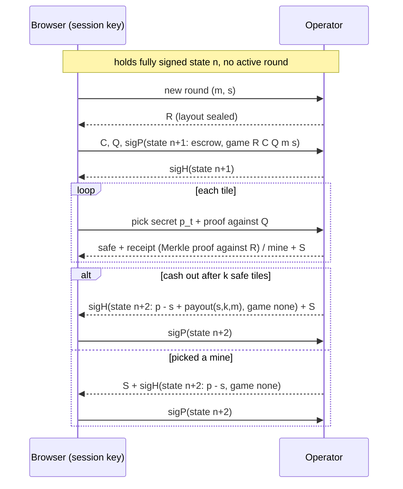
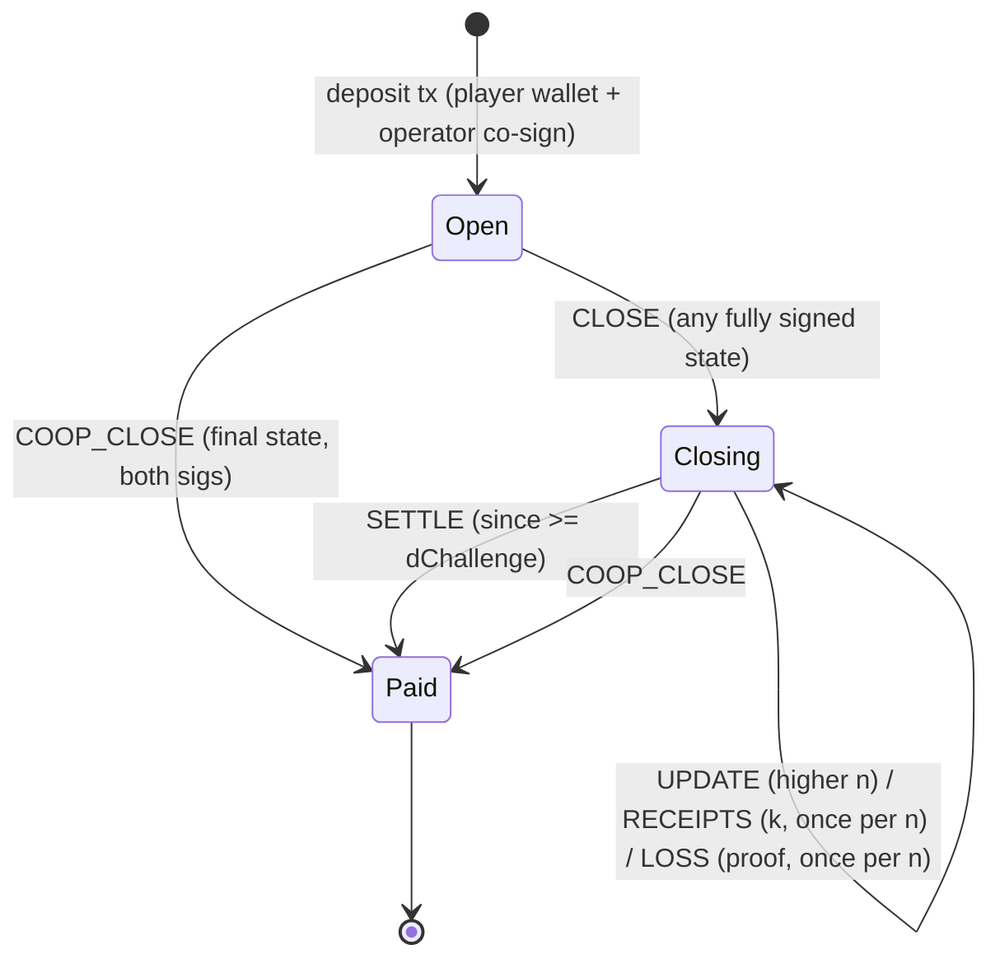

# ADR 0001: Multi-round sessions (deposit once, cash out when you want)

- **Status:** Accepted and implemented, 2026-11-14. The owner approved the section 10 defaults; spike passed (section 12); implementation in section 13; results in [PLAN.md](../../PLAN.md) section 2.2.
- **Supersedes:** nothing. The single-game protocol (SPEC sections 4–6, `mines-lock`) stays deployed and working.

## 1. Context

Today one game is one bet cell. Every game therefore costs two on-chain transactions and two wallet signatures (popups):

| Step | Measured on testnet, 2026-11-14 |
|---|---|
| Place bet: sign, broadcast, wait for the block, UI unlocks | about 45–50 s |
| Open tiles | 1–2 s each, off-chain |
| Cash out: sign, broadcast, wait for the block | about 40 s |

We cannot reveal tiles before the bet transaction is committed. If we did, a player who saw a mine could double-spend the bet's input (replace-by-fee) and cancel the game, which is a free option.

The owner wants the player to deposit once, play as many rounds as they like with near-instant feedback, and withdraw only when they choose.

## 2. Decision

Add a second lock, **`mines-session`**: a two-party state channel between one player and the operator.

- **One deposit transaction** opens a session cell holding the player deposit `P` and the operator deposit `H`. The wallet signs once.
- **Rounds are off-chain.** Each round moves balances by updating a **state** signed by both sides:
  - the player signs with a **session key**, a fresh secp256k1 key generated in the browser for this session (no wallet popup);
  - the operator signs with its server key.
- **Withdrawal is one transaction.** Normally both sign a `final` state and it pays out at once. If either side stops cooperating, the other closes unilaterally. After a challenge window `D_challenge`, the latest state pays out.
- **The game rules on-chain do not change.** A round left unfinished at close is resolved exactly as the single-game paths B and C resolve it today: the operator's loss proof, or the player's receipts. The protocol library functions are reused unchanged.

Payouts always go to the player's **wallet lock**, fixed in the session args. The session key can only sign states; it can never redirect money.

## 3. Goals and non-goals

**Goals**
- Rounds after the first deposit feel instant: no block wait, no popup.
- The player never has to trust the operator with funds, same as today: the operator cannot rig a layout, keep a won payout, or take more than the rules allow.
- Withdraw at any time with one transaction when both sides are online.

**Non-goals (this ADR)**
- Top-ups or partial withdrawals inside a session. Close and reopen instead.
- More than one active round per session.
- Watchtowers (third parties who defend an offline player).
- Fiber network integration (see section 9).
- Mainnet.

## 4. Session cell and state

### 4.1 Session args (in the lock args, after the 35-byte ckb-js-vm prefix)

| Field | Size | Meaning |
|---|---|---|
| `playerLockHash` | 32 | player's wallet lock; every player payout goes here |
| `houseLockHash` | 32 | operator lock; every operator payout goes here |
| `playerKeyHash` | 20 | blake160 of the player's session public key |
| `houseKeyHash` | 20 | blake160 of the operator's state-signing public key |
| `dChallenge` | 8 | challenge window in seconds (relative timestamp `since`) |

`argsHash = H(args)` identifies the session. A fresh session key per session makes every state signature unique to that session, so old states can never be replayed into a new session.

### 4.2 State (off-chain, signed by both)

```text
State {
  n:      u64                  // strictly increasing per update
  p:      u64                  // player balance, shannons
  h:      u64                  // operator balance, shannons
  final:  u8                   // 1 = both agree to close now
  game:   none | { R, C, Q: 32 bytes each, m: u8, s: u64 }   // the active round, if any
}
stateHash = H("mines/state" || argsHash || encode(State))
signatures: 65-byte recoverable secp256k1 over stateHash, one per key
```

**Invariant:** `p + h + escrow(game) == T`, where `T` is the session cell capacity and `escrow = C(9,m)·s`. This is the same amount a single-game bet cell locks today: the stake plus the operator's collateral.

### 4.3 Client and server rules for signing a state

- **New round:** `s ≤ p`, and `p − s` is either `0` or at least 61 CKB, so no balance becomes unpayable dust. The operator collateral must fit: `(C(9,m)−1)·s ≤ h`.
- **Win:** the round settles to `p' = p − s + payout(s, k, m)`, where `payout` is the existing protocol function with the 5%-of-profit fee.
- **Loss:** the round settles to `p' = p − s`.
- **Per round:** the operator reveals the seed `S` when the round settles, win or lose. The client runs the five Verify checks immediately.

## 5. A round, off-chain



**Why this signing order is safe.** At every moment each side holds the latest fully signed state, or the previous one plus evidence that gives the same result on-chain:

- If the operator withholds `sigH(n+1)`, the player still holds `n`. No round started and nothing is lost.
- If the operator refuses to sign a cash-out, the player still holds `n+1` and the receipts. On-chain resolution pays `payout(s,k,m)`, exactly what `n+2` would have paid.
- If the player refuses to sign the loss, the operator holds `n+1` and the loss proof (the mine tile's pick secret, which the player had to send, and `S`). On-chain resolution gives the operator the escrow.

A refusing party gains nothing. All it can do is force an on-chain close, which also ends its own session.

## 6. On-chain transitions

The first byte of `WitnessArgs.lock` selects the mode, as in `mines-lock`. Data encodes the cell state:

- **open:** empty data;
- **closing:** `{ n: u64, stateHash: 32, k: u8, lossProven: u8 }`, 42 bytes.

The full state and its signatures travel in the witness. The script recomputes `stateHash`, checks both signatures, and checks it against the data. Keeping only the hash in data keeps the closing cell small.



| Mode | Input → output | Script checks |
|---|---|---|
| `COOP_CLOSE` | open or closing → payouts | both signatures on a state with `final = 1` and no active round; outputs pay `p` to `playerLockHash` and `h` to `houseLockHash` |
| `CLOSE` | open → closing | both signatures; invariant holds; closing data `= { n, stateHash, 0, 0 }`; same lock and capacity |
| `UPDATE` | closing → closing | both signatures on a state with `n' > n`; resets `k` and `lossProven` |
| `RECEIPTS` | closing → closing | state matches `stateHash`; round active; `k == 0` and not `lossProven`; `checkReceipts` (existing) returns `k' > 0` |
| `LOSS` | closing → closing | state matches; round active; not yet `lossProven`; `checkLoss` (existing path-B check) passes |
| `SETTLE` | closing → payouts | relative `since ≥ dChallenge` on the closing input; payouts per section 7 |

- **Every mode:** exactly one session cell in the script group, and no other cell is spent with this lock.
- **No signature on the transaction itself:** state signatures are self-authenticating, so anyone can submit (the operator, the player, a future watchtower).
- **Front-running:** an outsider can at most choose the fee, and the fee is capped (section 7).

## 7. Settlement rules

**Final balances.**
- No active round: player gets `p`, operator gets `h`.
- Round active and `lossProven`: player gets `p`, operator gets `h + escrow`.
- Round active, not `lossProven`: player gets `p + payout(s, k, m)` with `k` from posted receipts (`k = 0` returns the stake), operator gets the rest.

**Dust.** A share below 61 CKB cannot be its own cell. It goes to the other side, the same rule as today's exit path. The signing rules in 4.3 keep the player's balance out of that range.

**Fees.** Each transition may spend at most `MAX_FEE` (proposal: 0.01 CKB) from the cell capacity. Fees come out of the operator's share. Only when the operator's share is too small do they come out of the player's.

**Capacity.** The closing cell must still cover its occupied capacity. Measured: the session cell occupies 188 CKB and the closing cell 230 CKB (188 plus 42 bytes of data). The lock never runs on the deposit transaction (it only creates the cell), so the player client and the server both refuse a deposit with `T < 230 CKB + 4 × MAX_FEE`. Without that margin a unilateral close could not create its closing cell.

**Challenge window and liveness.** Every closing transition recreates the cell, so the relative `since` restarts. That cannot be abused:
- The honest side answers any close by posting its latest state, and nothing can be posted after the latest state.
- Receipts and the loss proof can each be posted once per state.
- Worst case, a close takes about 4 × `D_challenge`.

## 8. Security review

| Threat | Outcome |
|---|---|
| Operator rigs a layout | Impossible as today: `R` is signed into state `n+1` before the player commits `C` and `Q`, and `S` is checked against `R` |
| Operator refuses to pay a win | Player closes with `n+1` and posts receipts. Paid by the rules after the window. |
| Operator posts an old state where it had more | Player posts the later state within `D_challenge`. **Requires the player (or their browser) to come online within `D_challenge`.** |
| Player posts an old state where they had more | Operator server watches the chain and posts the later state automatically |
| Player hits a mine, goes silent, posts receipts | Operator posts the loss proof. The loss proof takes precedence over receipts. |
| Session key stolen (for example by XSS) | The thief can sign states and play rounds with the player's balance, but payouts still go to the wallet lock. Losing on purpose only moves money to the operator. Low value to an outsider; serious only if the operator colludes. |
| Browser storage lost | The player cannot answer a stale close and loses unposted receipts. Same exposure as today's receipts. Mitigation: downloadable session backup. |
| Operator "last look" (stalls instead of issuing a receipt) | Exists today too: the player closes with the receipts held. Already listed for v1.0 hardening. |

**What gets weaker than today:**
- **Liveness.** The single-game protocol already asks the player to act within `D_forfeit` if the operator stalls. Sessions add one requirement: answer a stale close within `D_challenge`.
- **Verify.** A round's commitments live in an operator-signed state rather than in a bet cell on chain. The operator's signature binds it just as firmly, but anyone verifying needs the signed state from the player.

## 9. Alternatives considered

| Option | Why not (now) |
|---|---|
| **A. Keep single games; don't block the UI after cash-out** | Cheap (hours) and saves about 40 s per game, but the 45 s wait before each game remains. Still worth doing as a stop-gap. |
| Pre-signed transactions with the wallet as a 2-of-2 (Lightning style) | Every round needs a wallet signature, so the popup stays. Wallet-lock multisig with JoyID is unclear. |
| Fiber (CKB payment channels) | Fiber pays instantly but cannot enforce the game rules: nothing forces the operator to pay a win. It would need custom conditional payments tied to the game, plus Fiber node infrastructure. Worth revisiting later. |
| Reveal tiles before the bet is committed | Gives the player a free option (cancel by double-spending after seeing a mine). Rejected. |

## 10. Open decisions (owner)

1. **`D_challenge`.** Proposal: 24 h in production, short values for testnet runs. A shorter window releases a disputed withdrawal faster but asks more of an offline player.
2. **Single-game mode.** Keep it in the UI next to sessions, or hide it? Proposal: keep the lock deployed and the code tested, but make sessions the default in the UI.
3. **Operator deposit per session.** The player picks a maximum bet when opening, and `H` is sized to cover it: for example Hard at 20 CKB needs 2,500 CKB. This determines how many sessions the operator can fund at once. With today's ~43k CKB, about 17 sessions at the maximum.
4. **Idle sessions.** The operator closes a session after N minutes without a round. Proposal: cooperatively if the tab is open, otherwise unilaterally with the latest state.
5. **Order of work.** Spike first (step 1 below), then decide whether to continue.

## 11. Work and verification

Hours are estimates, not measurements.

| Step | Scope | Estimate |
|---|---|---|
| 1. Spike | Cycle cost of `secp256k1.recover` in ckb-js-vm, worst-case `LOSS` and `RECEIPTS` cycles, exact closing-cell capacity | 4 h |
| 2. Protocol | State encoding, `stateHash`, settlement math, golden vectors | 6 h |
| 3. Script | `mines-session` with the six modes; ckb-testtool tests for every mode and every rejection | 16 h |
| 4. Chain | Transaction builders; `SessionPlayer` SDK: key, states, rounds, close and defense | 8 h |
| 5. Server | Session tables, round endpoints, chain watcher that answers stale closes and posts loss proofs | 12 h |
| 6. Web | Session panel (deposit, balance, rounds, withdraw), key backup, check for closes on load | 10 h |
| 7. E2E and drills | Rounds at scale; drills for stale close by either side, receipts dispute, loss dispute, operator killed mid-round | 8 h |
| **Total** | | **about 64 h**, roughly 6–7 weeks at 10 h/week |

The success bar stays the same as Phase 1: at least 95% of E2E sessions settle with exactly the right amounts, 100% of unit tests pass, and every drill passes.

## 12. Spike results (2026-11-14)

The full rule set was written: `packages/protocol/src/session.ts` (`checkSession`) and the thin lock `packages/script/contracts/mines-session`. It was measured under ckb-testtool; 31 tests cover every mode and every rejection.

| Mode | Cycles, bytecode | Cycles, JS source |
|---|---|---|
| coop close (2 signatures) | 18.5M | 59.7M |
| close (2 signatures) | 18.7M | 59.9M |
| update | 18.7M | 59.9M |
| receipts, 7 tiles (worst case) | 21.7M | 62.9M |
| loss proof | 21.6M | 62.8M |
| settle | 16.4M | 57.5M |

**Facts**
- The VM's native `secp256k1.recover` costs little: two recoveries plus the state hash add about 2.3M cycles (close vs settle).
- Most of the JS-source cost is parsing the script (about 57M), so the worst case is fixed and does not grow with input.
- Deployment costs one CKB per byte: JS source 29,571 CKB, bytecode 37,178 CKB. The operator holds about 40.2k CKB, plus about 3.2k CKB in the test players' wallets.
- Session cell 188 CKB, closing cell 230 CKB.
- Splitting the session code into its own module keeps `dist/mines-lock.js` byte-identical to the deployed lock (data hash `0x944bc58d…5170`).

**Decision: go, and deploy the JS source.**
- The bytecode would leave only about 6k CKB for operator deposits.
- The JS worst case (62.9M) stays under the default tx-pool limit `max_tx_verify_cycles = 70,000,000`. [Assumption: public testnet nodes run the default.]
- Session transitions take their fee from the cell capacity and need no other inputs, so the transaction total is the lock's own cost.
- **Risk:** only about 7M cycles of headroom. Any future rule that adds cycles must be measured. Switching to bytecode is the fallback once more CKB is available.

## 13. Implementation (2026-11-14)

| Piece | Where |
|---|---|
| Rules, encodings, shares | `packages/protocol/src/session.ts` |
| Lock | `packages/script/contracts/mines-session`, deployed as JS source (section 12) |
| Transactions, state signing, cell following | `packages/chain/src/session.ts` |
| Player SDK | `packages/chain/src/session-player.ts` (`SessionPlayer`) |
| Operator | `apps/server/src/sessions.ts` (endpoints), `apps/server/src/session-watcher.ts` (chain defense) |
| UI | `apps/web/app/Session.tsx`, the default Play tab; single games moved to a "Single game" tab |

**Operator API.**
- `POST /api/sessions`: terms, the operator half of the deposit, and the operator's signature on state 0.
- `POST /api/sessions/:id/open`: the player's signature on state 0 and its signed deposit. The client stores the session key and the co-signed state 0 **before** it sends this, so it can close alone as soon as the deposit lands.
- `POST /api/sessions/:id/rounds`: seal a layout (`R`). Then `.../rounds/:round/commit`: `C`, `Q` and the player's signature on state n+1; the operator countersigns.
- `.../rounds/:round/reveal`: a receipt, or the seed plus the operator's signature on the loss state.
- `.../rounds/:round/cashout`: the seed plus the operator's signature on the win state.
- `POST /api/sessions/:id/ack`: the player's signature on the state that ended the round. A new round, or a withdrawal, waits for it.
- `POST /api/sessions/:id/withdraw`: the player's signature on the final state. The operator countersigns and broadcasts the payout; the client builds the same transaction and sends it too, so a silent operator cannot hold it back.

**Choices made while building.**
- **House key.** The operator signs states with its wallet key, so `houseKeyHash` equals its lock args.
- **Operator deposit.** `H = 125 × maxBet`, which covers the best case on Hard. After the player wins, `h` shrinks, and so does the largest stake per difficulty. The UI disables a difficulty the deposit no longer covers.
- **Idle sessions.** The operator closes an idle session unilaterally after `SESSION_IDLE`, with its latest state. It does not first try a cooperative close (decision 4 proposed that); the player keeps everything it is owed, and only waits `D_challenge` longer.
- **Unsigned win.** If the player never countersigns a win and the session ends on chain, the operator posts the receipts it issued itself, so the player is paid as the rules say.
- **An abandoned round** (tiles opened, no cash-out, no loss) settles with `k` = posted receipts, and `k = 0` returns the stake.
- **Following the cell.** Both sides follow the session cell through the transaction that spent it, instead of searching for the live cell, so a lagging indexer cannot make a closing session look paid out.
- **Opening race.** The deposit can commit before the operator's watcher marks the session open, and the operator refuses rounds until then. The client waits until the deposit transaction is committed and the operator no longer reports `opening`.
- **House reservations.** A reservation row for a cell the node does not report live is dropped at once, not kept. Keeping it (the single-game behaviour) leaked live cells whenever the public RPC's indexer ran ahead of its node, and sessions create new house cells often enough to make that visible.
- **Capacity.** One house cell of `H + 61 CKB` backs one opening session. The number of sessions the operator can open at once is the number of such free cells; split the balance accordingly (`scripts/house-split.ts`).
