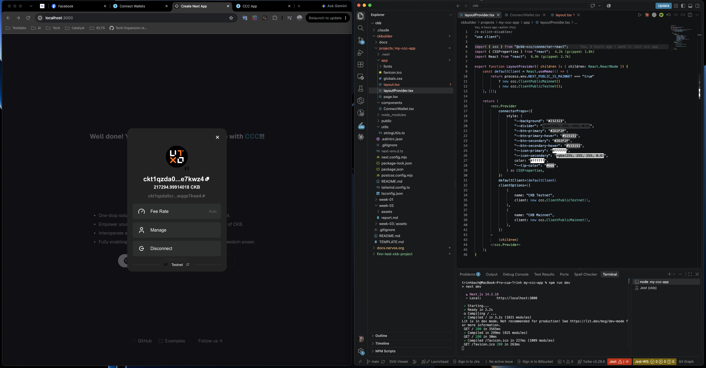
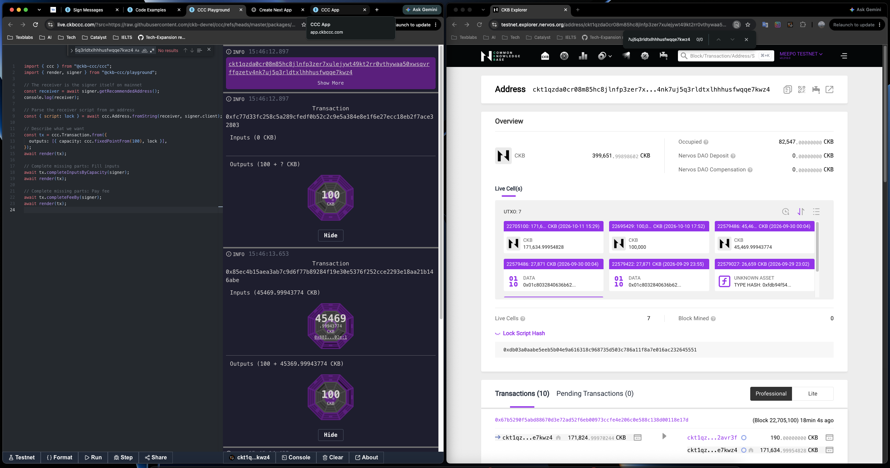
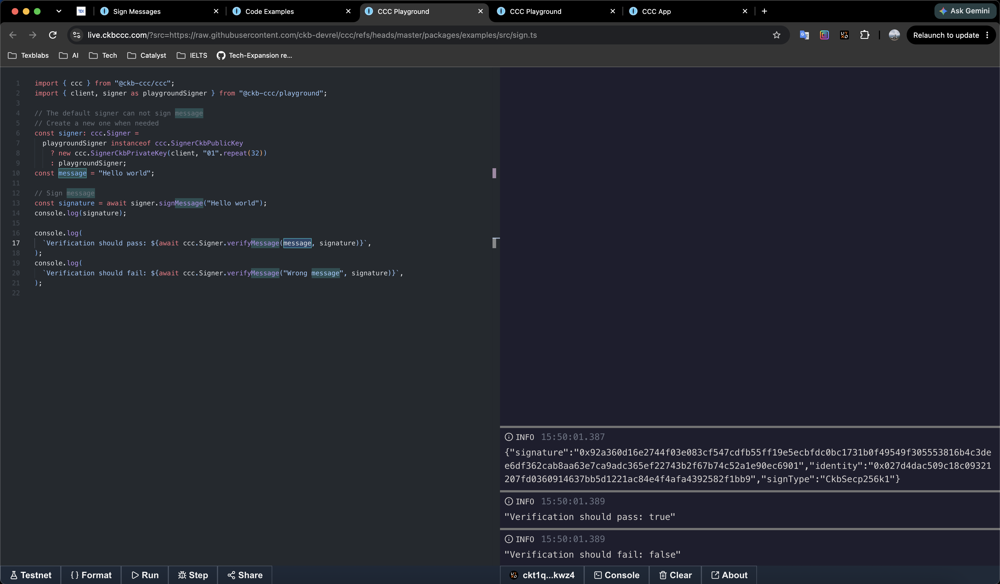
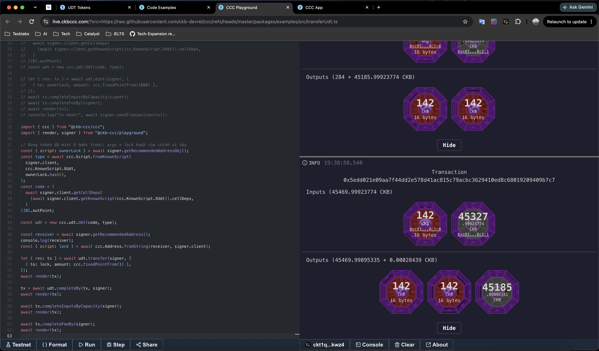
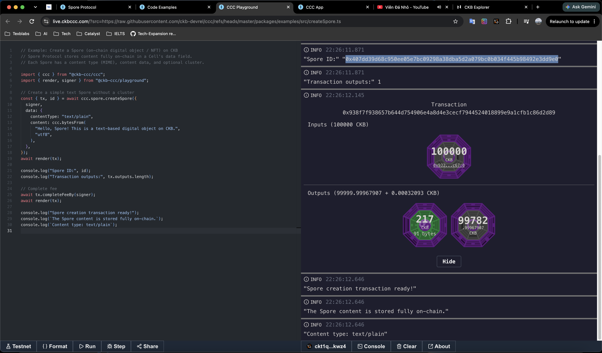
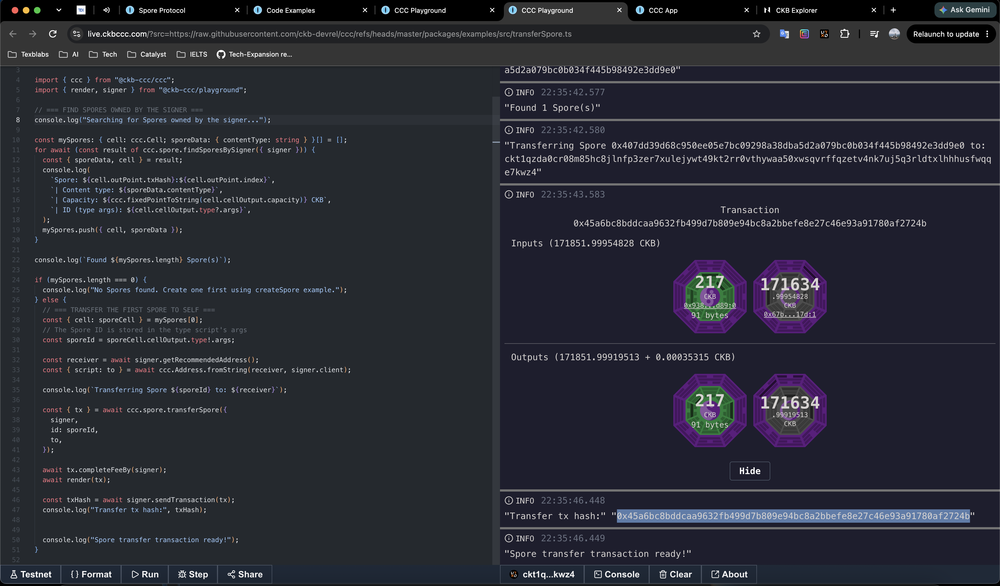
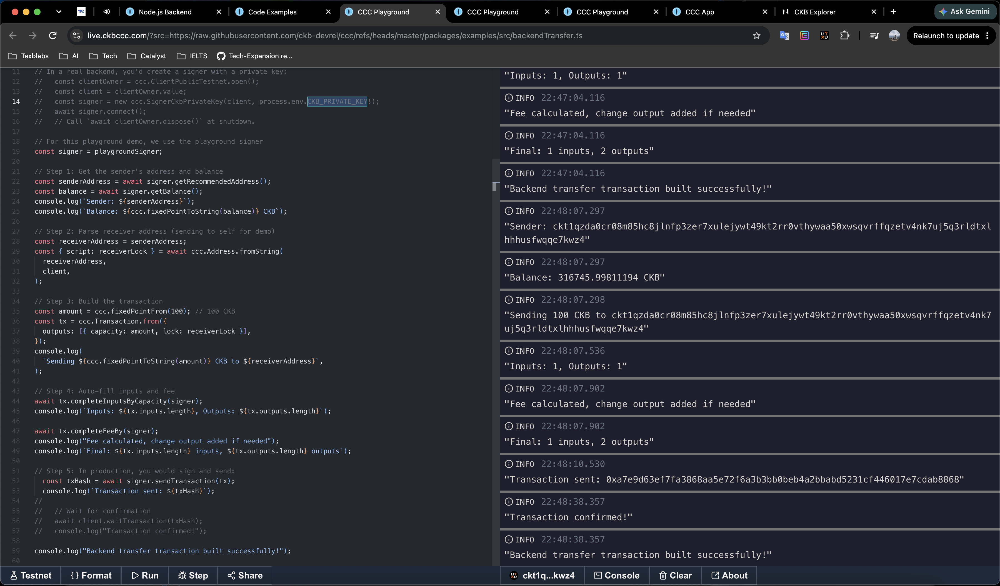

# Week 3 — week ending 2026-10-11

**Name:** Trinh Bach · **Track:** CKBuilders
**Focus:** CCC guides: wallets, transactions, message signing, UDT, Spore and the Node.js backend

## 1. Covered this week

| Item | Status |
|---|---|
| [Connect Wallets](https://docs.ckbccc.com/en/docs/guides/connect-wallets) | Done |
| [Compose Transactions](https://docs.ckbccc.com/en/docs/guides/compose-transactions) | Done |
| [Sign Messages](https://docs.ckbccc.com/en/docs/guides/sign-message) | Done |
| [UDT Tokens](https://docs.ckbccc.com/en/docs/guides/udt-tokens) | Done |
| [Spore Protocol](https://docs.ckbccc.com/en/docs/guides/spore-protocol) | Done |
| [Node.js Backend](https://docs.ckbccc.com/en/docs/guides/node-js-backend) | Done |
| [Code Examples](https://docs.ckbccc.com/en/docs/code-examples) | Done |
| [AI Resources](https://docs.ckbccc.com/en/docs/ai-resources) | Done |
| [Packages](https://docs.ckbccc.com/en/docs/packages) | Skimmed |
| [Migrate to Connector 2.0](https://docs.ckbccc.com/en/docs/migration/connector-v2) | Skimmed |

## 2. Key learnings

**Connecting wallets**

*What it is: the step that lets a dApp talk to the user's wallet. Once connected, the app gets a `Signer` it can use to read the address and balance and to ask the wallet to sign. Every other guide below starts from this.*

- There are three ways in. `ccc.Provider` in React gives a ready-made modal and state. `SignersController` lets me build my own wallet picker. A direct signer such as `new ccc.JoyId.CkbSigner(...)` skips discovery and talks to one wallet only.
- The two hooks I use most are `ccc.useCcc()` (open the modal, read `wallet`, switch client) and `ccc.useSigner()`. `useSigner()` is `undefined` until a wallet is connected, so every call that needs a signer has to be guarded.
- `signerFilter` hides wallets I don't want, for example keeping only `SignerType.CKB`. `clientOptions` is what puts the Testnet / Mainnet switch in the modal.
- Anything using the Provider or hooks needs `"use client"` in Next.js. CCC also remembers the last connection in `localStorage`, which is why the Provider belongs in the root layout.

**Composing transactions**

*What it is: building a CKB transaction in code, for example sending CKB to an address. I only say what the outputs should be, and CCC picks the input Cells, adds the fee and the change, then has the wallet sign and send it.*

- The pattern is always declare outputs → fill inputs → pay fee → send, and the docs reuse it for every transaction. My reading of why the order matters: the fee and the change output depend on which inputs were picked.
- The wallet needs the outputs *plus* a minimum change Cell of 61 CKB, otherwise `completeInputsByCapacity` throws "not enough capacity". 61 CKB is the minimum size of a basic Cell, and a Cell below that is rejected with `InsufficientCellCapacity`.
- The fee rate is fetched automatically (node median) and can be overridden in shannon per kilobyte.
- To send everything: leave `capacity` off the output, use `completeInputsAll`, then `completeFeeChangeToOutput(signer, index)` so the fee comes out of that output instead of a change Cell.
- `render(tx)` in the Playground only draws the transaction (what I saw when running the examples). Nothing reaches the chain until `signer.sendTransaction(tx)` is called, which signs and broadcasts.

**Signing messages**

*What it is: having the wallet sign a piece of text, without any transaction. It is used to prove that someone controls an address, for example "sign in with wallet", and costs no fee.*

- `signMessage` returns an object `{ signature, identity, signType }`, not a bare string. `signType` (`CkbSecp256k1`, `EvmPersonal`, `BtcEcdsa`, `JoyId`, ...) tells a verifier how to check it, so the static `ccc.Signer.verifyMessage` needs no wallet at all. That also means a backend can verify a login signature.
- Signing is off-chain: no transaction, no hash, nothing on the explorer. It proves control of an address ("sign in with wallet"). The docs don't mention replay protection; I would expect the app to add something like a nonce itself.
- There are two verify calls: the static `ccc.Signer.verifyMessage` accepts any signature, while `signer.verifyMessage` also checks that `identity` belongs to that signer.
- Some signers are public-key only (the Playground default `SignerCkbPublicKey`) and cannot sign. The example swaps in a throwaway `SignerCkbPrivateKey` only in that case.

**UDT tokens**

*What it is: fungible tokens on CKB (like ERC-20 on Ethereum). With CCC I can issue my own token (mint) and send it to other addresses (transfer).*

- A UDT is just a Cell whose type script defines the token and whose data holds the amount. `ccc.udt.Udt` is built from two things: the code OutPoint (used as a cell dep) and the type script.
- The type script `args` are normally the issuer's lock hash. That is what identifies the token, and it is also what gives mint rights (owner mode: signer's lock hash equals the args).
- Transfer has four steps: `udt.transfer` → `udt.completeBy` (UDT inputs and change) → `completeInputsByCapacity` (CKB for the Cells) → `completeFeeBy`. The result comes back wrapped, so the transaction is in `.res`.
- Sending to a brand-new holder needs no setup. The transfer creates a new Cell and the sender pays its capacity.
- xUDT is the one to use; sUDT is legacy. `name()` / `symbol()` / `decimals()` only work for SSRI tokens.

**Spore protocol**

*What it is: a standard for on-chain digital objects (NFTs / DOBs), where the content itself is stored inside a Cell instead of a link to somewhere else. With CCC I can create, transfer, find and destroy them.*

- A Spore is content (MIME type plus bytes) stored in one Cell, with a lock for ownership. The content is permanent, only the owner changes. `createSpore`, `transferSpore`, `meltSpore` (destroys it and returns the CKB), and `findSporesBySigner` cover the lifecycle.
- The Spore ID is the type script `args`, so it has to be saved: transfer and melt both need it. Clusters group Spores, and `clusterMode: "lockProxy"` is the recommended (lower cost) mode.
- Spores need much more CKB than a plain transfer (the docs say 200+ CKB for a text Spore). In my runs capacity grows about 1 CKB per byte: this Spore has 91 bytes and a 217 CKB Cell, last week's 47-byte Spore needed 173 CKB, and the 44-byte difference matches the 44 CKB difference.
- A transfer spends the Spore Cell and creates a new one with the new owner's lock. I sent it to myself, so the new Cell is again 217 CKB and the fee was 0.00035315 CKB.

**Node.js backend**

*What it is: using CCC on a server or in a script, with no browser or wallet extension. It is for automated jobs such as airdrops, payouts or bots, where the program holds a private key and signs by itself.*

- `@ckb-ccc/shell` is the Node bundle: core plus `spore`, `udt` and `ssri`. It is ESM-only, so `ERR_REQUIRE_ESM` means the project needs `"type": "module"`.
- `ClientPublicTestnet.open()` returns an owner object. I read `.value` and call `dispose()` when done.
- Browser wallets cannot run on a server. A backend signs with `SignerCkbPrivateKey(client, privateKey)`, the same Transaction and message APIs as the frontend. The key must be 32 bytes without `0x`, and must never be hardcoded.
- Public nodes may be rate-limited; for production the docs suggest running my own node and passing its URL to `open({ urls })`.

**Tooling**

*What it is: the supporting material around the guides: ready-made example scripts, resources for AI coding assistants, and a map of which npm package to install for what.*

- Code Examples is a gallery of runnable scripts. Any raw GitHub URL opens in the Playground as `https://live.ckbccc.com/?src=<raw-url>`.
- AI Resources exists because the Cell model barely appears in the data LLMs were trained on, so assistants write CCC code that looks right but isn't (wrong order, invented methods, `number` instead of `bigint`). CCC ships Agent Skills for Cursor, Claude Code, Copilot and others, plus a setup, prompting and verification guide. The docs also have an `llms.txt` index, and adding `.md` to a page URL returns its Markdown source.
- Packages: `shell` for Node.js, `connector-react` for React apps, `ccc` for a custom wallet UI, `core` for deep customization. The protocol SDKs `spore`, `udt` and `ssri` are separate packages, but `shell` re-exports all three and `ccc` exposes `ccc.spore` / `ccc.udt` too (the UDT guide says no extra install is needed with `@ckb-ccc/ccc`).
- Connector 2.0 migration (skimmed): `useCcc().setClient` now takes an owned client such as `ccc.ClientPublicMainnet.open()` instead of a bare `new Client()`, so the Provider can dispose it. A client passed through `defaultClient` / `clientOptions` stays caller-owned, as in my app.

## 3. Practical progress

- **Connect Wallets.** Ran `my-ccc-app` (the Next.js scaffold from week 2, now under `projects/`) on testnet and connected a wallet. The modal shows the address, 217,294.99914018 CKB, the Fee Rate setting and the Testnet switch. The Provider is in [`layoutProvider.tsx`](../projects/my-ccc-app/app/layoutProvider.tsx).
  

- **Compose Transactions.** Built a 100 CKB transfer step by step in the Playground. After each step the transaction is rendered again: inputs filled (45,469.99943774 CKB), then the fee and change output (100 + 45,369.99943774 CKB).
  

- **Sign Messages.** Signed "Hello world" and verified it. `verifyMessage` gives `true` for the original message and `false` for "Wrong message". The returned `identity` is the compressed public key `0x027d4d…`, and `signType` is `CkbSecp256k1`.
  

- **UDT Tokens.** Minted 1,000 of my own xUDT (type args = my lock hash), then transferred 1 token. The example's own script hardcodes someone else's token, so I had to issue my own before the transfer worked. Script: [`create-then-transfer-udt`](additional-scripts/create-then-transfer-udt).
  

- **Spore Protocol.** Created a text Spore (ID `0x407dd39d68c950ee05e7bc09298a38dba5d2a079bc0b034f445b98492e3dd9e0`, 217 CKB Cell, 91 bytes), then found it with `findSporesBySigner` and transferred it to myself. Script: [`create-then-transfer-spore`](additional-scripts/create-then-transfer-spore).
  
  
  Tx: `0x45a6bc8bddcaa9632fb499d7b809e94bc8a2bbefe8e27c46e93a91780af2724b`

- **Node.js Backend.** Ran the `backendTransfer` example in the Playground as a stand-in for a shell script: read the balance (316,745.99811194 CKB), built a 100 CKB transfer to myself (1 input, 2 outputs), sent it and waited for confirmation.
  
  Tx: `0xa7e9d63ef7fa3868aa5e72f6a3b3bb0beb4a2bbabd5231cf446017e7cdab8868`

## 4. Blockers / questions

None this week.
