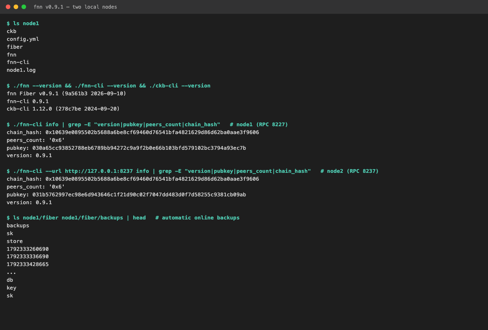
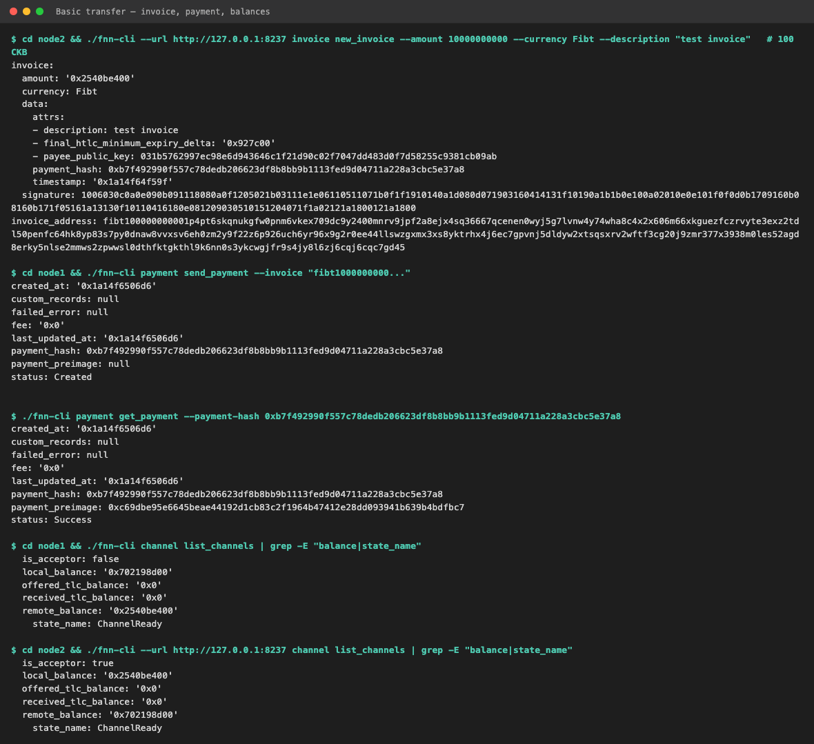
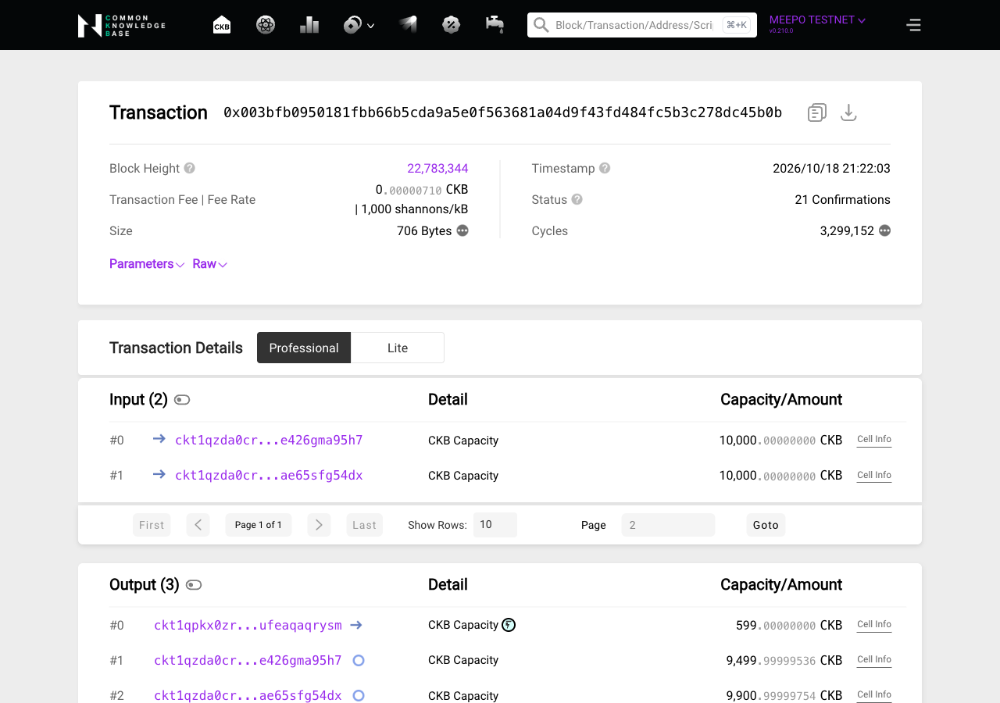
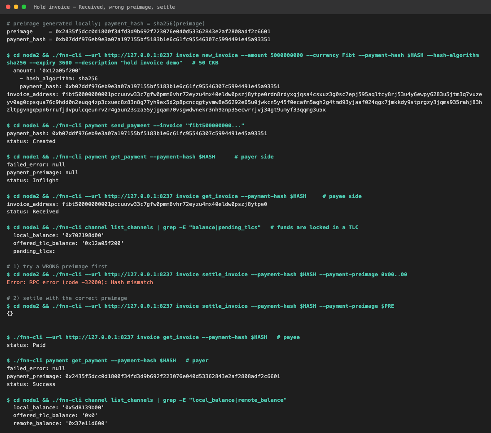
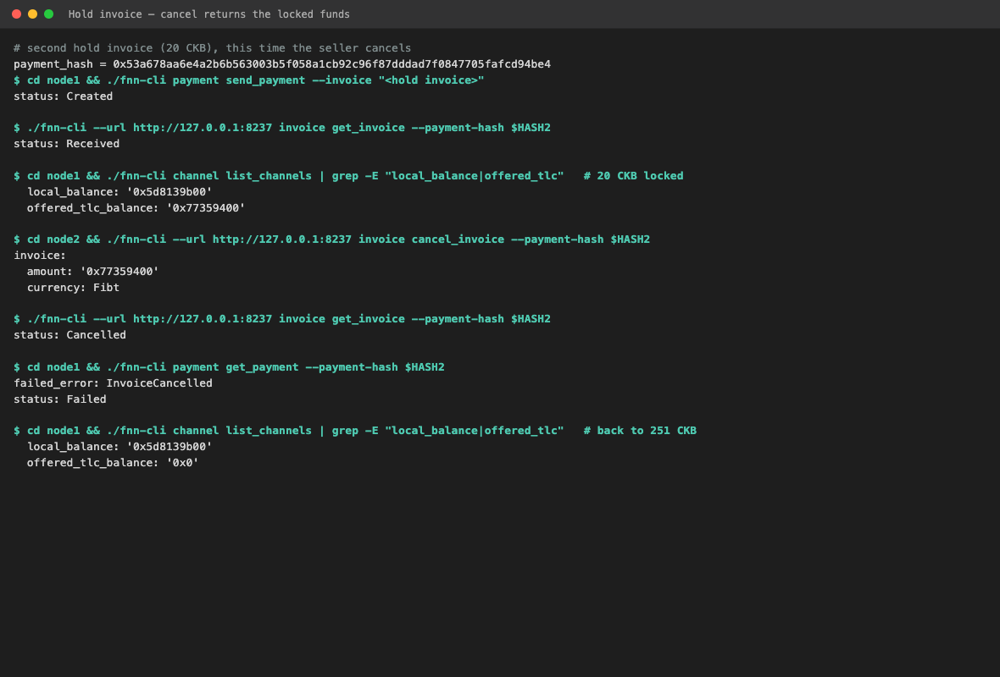
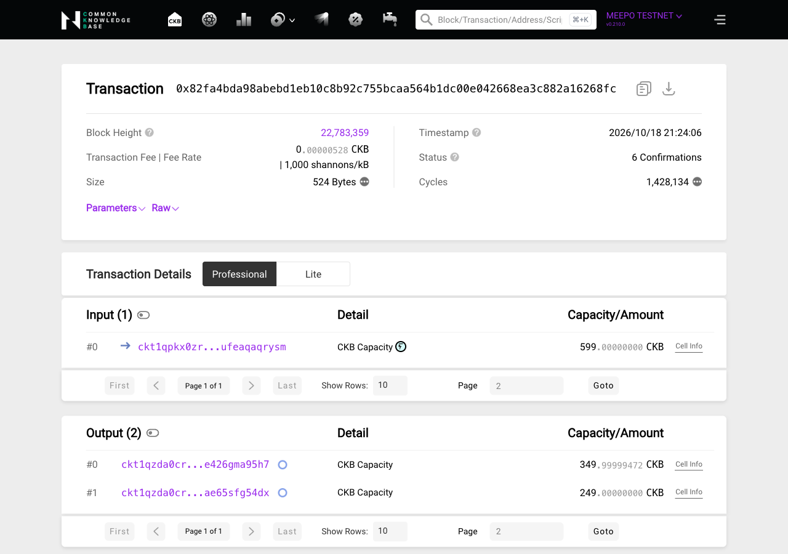
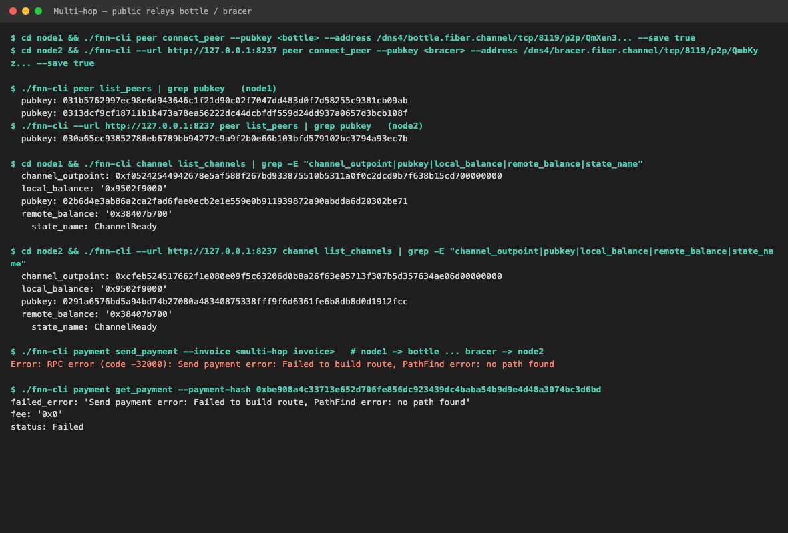
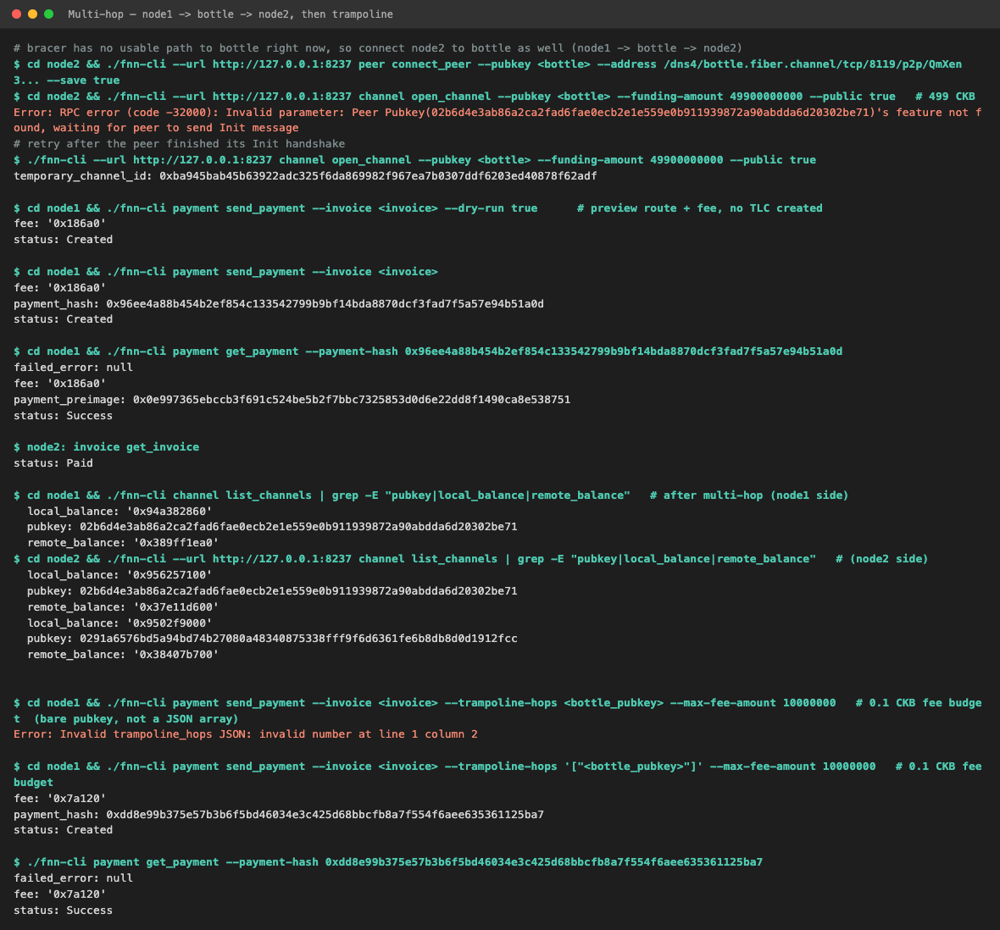

# Week 4 — week ending 2026-10-18

**Name:** Trinh Bach · **Track:** CKBuilders
**Focus:** Fiber Network (payment channels on CKB): running two local nodes on testnet, direct and multi-hop payments, hold invoices

Scope this week is only [fiber.world/docs](https://www.fiber.world/docs).

## 1. Covered this week

| Item | Status |
|---|---|
| [What is Fiber Network?](https://www.fiber.world/docs) | Done |
| [How Fiber Network Works](https://www.fiber.world/docs/how-it-works) | Done |
| [Run a Native Node](https://www.fiber.world/docs/quick-start/run-a-node/rust) | Done (manual install) |
| [Basic Transfer](https://www.fiber.world/docs/quick-start/basic-transfer) | Done |
| [Multi-hop Transfers](https://www.fiber.world/docs/quick-start/multi-hop-transfer) | Partial (both nodes through one public relay) |
| [Network Resources](https://www.fiber.world/docs/quick-start/network-resources) | Done |
| [Channel Lifecycle](https://www.fiber.world/docs/concept/channels/channel-lifecycle) | Done |
| [Invoice](https://www.fiber.world/docs/concept/payments/invoice-guide), [Hold Invoice](https://www.fiber.world/docs/concept/payments/hold-invoice) | Done |
| [Multi-Hop Payments](https://www.fiber.world/docs/concept/routing/multi-hop), [Glossary](https://www.fiber.world/docs/res/glossary), [Toolchain Overview](https://www.fiber.world/docs/build/toolchain) | Skimmed |
| [Transfer Stablecoins](https://www.fiber.world/docs/quick-start/transfer-stablecoin) | Not done (needs RUSD) |

## 2. Key learnings

**What Fiber is**

*What it is: a payment channel network on CKB, the same idea as Bitcoin's Lightning Network. Two nodes lock funds in one on-chain Cell, then pay each other with signed balance updates that never touch the chain. Layer 1 is only used to open, close and settle disputes.*

- Payments don't wait for blocks, and the chain only sees two transactions per channel (open and close). In my first channel I made three payments and the explorer shows only the funding and the closing transaction.
- The channel is built from CKB scripts (a Funding Lock and a Commitment Lock, listed with their cell deps in `config.yml`), so it is the same lock / cell dep model from weeks 1–3. The node (`fnn`) exposes a JSON-RPC server on `127.0.0.1:8227` and `fnn-cli` is a thin client for it.

**Channels and the 99 CKB reserve**

- Opening a channel is one normal CKB transaction that creates one Cell. My 500 CKB channel Cell holds **599 CKB**: 500 from node1 plus 99 that node2 auto-contributed.
- Each side keeps 99 CKB in the channel (98 CKB because the commitment lock Cell needs that capacity, plus 1 CKB for the shutdown fee), so spendable balance is funding minus 99: node1 had 401 CKB, node2 had 0. The reserve comes back on a cooperative close: node1 got 349.99999472 CKB (251 + 99) and node2 got 249 (150 + 99).
- A channel goes `NegotiatingFunding` → `CollaboratingFundingTx` → `AwaitingTxSignatures` → `ChannelReady`. Opening took about 90 seconds. `ChannelReady` only means it is open, not that a payment will work.

**Invoices, TLCs and preimages**

- The receiver creates an invoice with a payment hash and keeps the preimage. The payer's funds are locked in a time-locked contract (TLC), and the receiver claims them by revealing the preimage, which becomes the payer's proof of payment.
- `send_payment` is asynchronous: it returned `Created` and the next `get_payment` returned `Success`. The CLI takes decimal shannons and the RPC takes hex strings; the testnet invoice currency is `Fibt`.

**Hold invoices**

*What it is: an invoice the receiver's node does not settle automatically. The payer's funds are locked in the network, but the receiver can't claim them until they reveal the preimage (settle) or give up (cancel).*

- A hold invoice is created with only the payment hash, so the node doesn't know the preimage. I made my own and hashed it with SHA-256, so I had to pass `--hash-algorithm sha256` (the default is blake2b).
- The receiver sees `Open` → `Received` and the payer sees `Inflight`; the 50 CKB showed up as `offered_tlc_balance`. A wrong preimage gives `Hash mismatch`; the right one makes the invoice `Paid`. `cancel_invoice` fails the payment with `InvoiceCancelled` and the locked amount goes back to the payer. Whoever holds the preimage decides, which is the escrow pattern the docs describe.

**Multi-hop and liquidity**

- Gossip gives each node the graph of channels and their **total capacity**, not the balance on each side. My node1 saw 34 nodes and 543 channels, but a route that exists in the graph can still fail when one hop has no outbound balance in that direction. Having funds is not the same as being able to pay.
- A relay's fee is `amount × tlc_fee_proportional_millionths / 1,000,000` (default 0.1%). Paying 1 CKB through one relay cost 0.001 CKB, and `--dry-run true` shows the fee without creating any TLC.

## 3. Practical progress

- **Install and run two nodes.** Installed `fnn` / `fnn-cli` v0.9.1 and `ckb-cli` v1.12.0 by hand from the GitHub releases, made two throwaway keys, and claimed 10,000 testnet CKB for each address from the faucet. node1 uses RPC 8227 / P2P 8228 and node2 8237 / 8238. On first start `fnn` encrypted `ckb/key`. Code and logs: [`project/`](project/README.md).
  

- **Basic Transfer.** `connect_peer`, then `open_channel` with 500 CKB and waited for `ChannelReady`. node2 created a 100 CKB invoice, node1 paid it, and the balances went from 401 / 0 to 301 / 100 CKB, all off-chain.
  
  Funding tx: [`0x003bfb0950181fbb66b5cda9a5e0f563681a04d9f43fd484fc5b3c278dc45b0b`](https://testnet.explorer.nervos.org/transaction/0x003bfb0950181fbb66b5cda9a5e0f563681a04d9f43fd484fc5b3c278dc45b0b)
  

- **Hold invoice.** On the same channel: a 50 CKB hold invoice was paid, held in `Received`, rejected with a wrong preimage, then settled (balances 251 / 150 CKB). A second 20 CKB hold invoice was paid and then cancelled, and the 20 CKB returned (`InvoiceCancelled`).
  
  

- **Close the channel.** Cooperative close: the one 599 CKB Cell was spent into 349.99999472 + 249 CKB, fee 0.00000528 CKB.
  Closing tx: [`0x82fa4bda98abebd1eb10c8b92c755bcaa564b1dc00e042668ea3c882a16268fc`](https://testnet.explorer.nervos.org/transaction/0x82fa4bda98abebd1eb10c8b92c755bcaa564b1dc00e042668ea3c882a16268fc)
  

- **Multi-hop through a public relay.** Connected node1 to `bottle` and node2 to `bracer`, and opened a 499 CKB channel on each. The docs' path through both relays never found a route:
  
  After I opened a second channel from node2 to `bottle`, the route node1 → bottle → node2 was found once gossip caught up. 1 CKB was paid with a 0.001 CKB fee (invoice `Paid`, payment `Success`), and a trampoline payment through bottle also worked.
  

At the end I closed all channels and stopped both nodes. Together they have 19,999.99 of the 20,000 CKB I started with; the cost was about 0.006 CKB of relay fees plus on-chain fees.

## 4. Blockers / questions

None this week.
