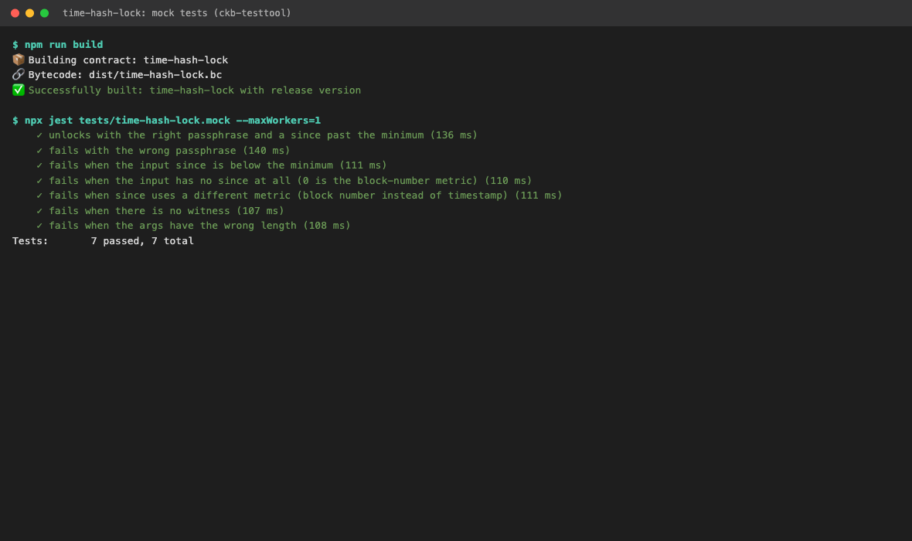
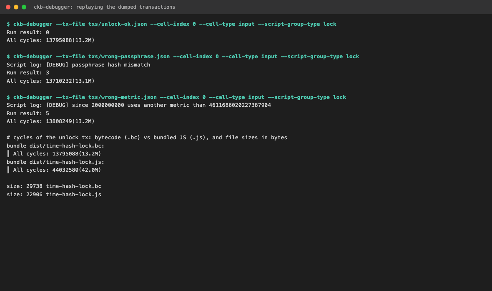
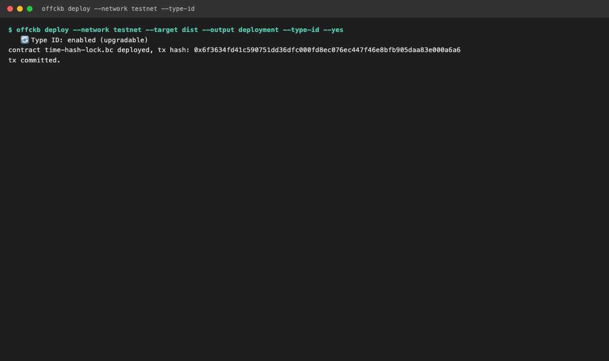
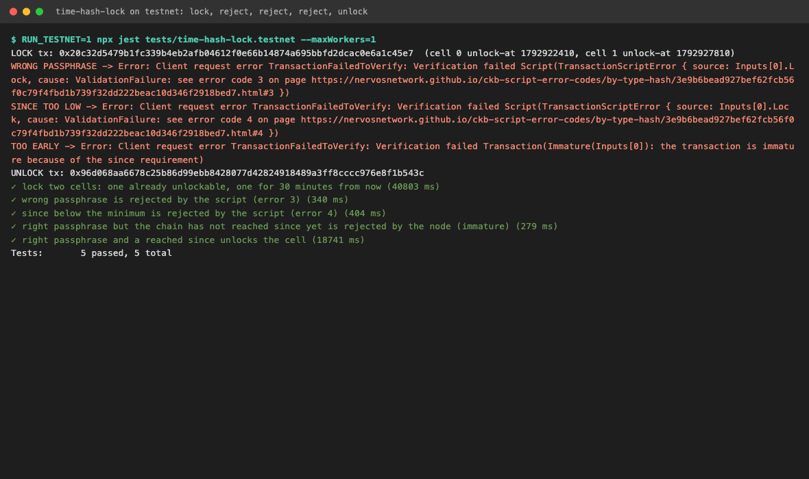
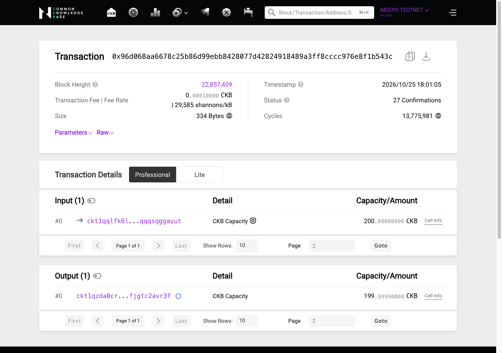
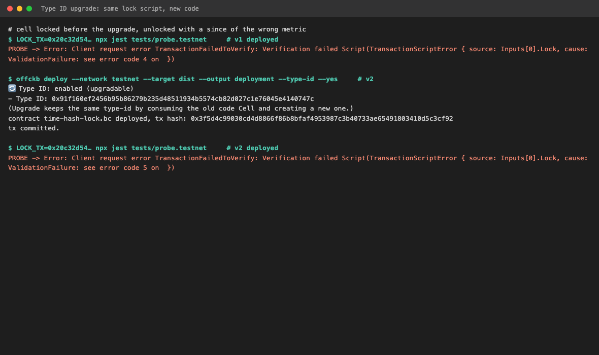
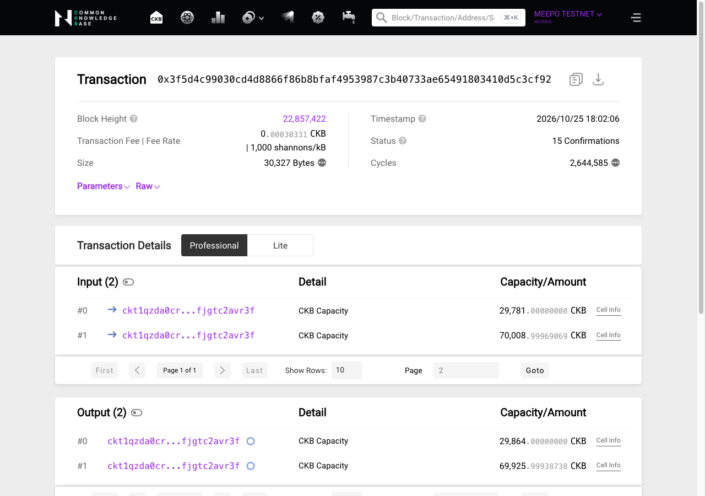

# Week 5 — week ending 2026-10-25

**Name:** Trinh Bach · **Track:** CKBuilders
**Focus:** Writing my first Script in TypeScript: a lock with a passphrase and a `since` timelock, tested, debugged, deployed to testnet and upgraded with Type ID

## 1. Covered this week

| Item | Status |
|---|---|
| [JavaScript Quick Start](https://docs.nervos.org/docs/script/js/js-quick-start) | Done |
| [JS API (Syscalls)](https://docs.nervos.org/docs/script/js/js-api-syscalls), [JS Tests](https://docs.nervos.org/docs/script/js/js-tests) | Done |
| [Debug Scripts](https://docs.nervos.org/docs/script/debug-script) | Done (CKB-Debugger part; GDB and native simulator skimmed) |
| [Type ID for Upgradable Scripts](https://docs.nervos.org/docs/script/type-id), [Upgrade Scripts](https://docs.nervos.org/docs/script/script-upgrade-workflow) | Done |
| [Regulate Scripts via Cycle Limits](https://docs.nervos.org/docs/script/vm-cycle-limits) | Done |
| [Serialization and Molecule in CKB](https://docs.nervos.org/docs/serialization/serialization-molecule-in-ckb) (schema language, encoding spec) | Skimmed |
| [xUDT](https://docs.nervos.org/docs/assets-token-standards/xudt) | Skimmed |
| Script course Classes 1–10 | Not available: the current docs no longer have a `script-course` section (it is not in the docs repo checkout from 2026-09-21), so I used the `script/` pages above instead |

## 2. Key learnings

**How a TypeScript lock runs**

*What it is: the script is a bytecode file (`.bc`) that `ckb-js-vm`, itself a RISC-V Script deployed on chain, loads and interprets. A cell uses it as its lock by pointing at `ckb-js-vm` and passing the bytecode's hash in the args.*

- The lock args are `2 bytes loader + 32 bytes code hash + 1 byte hash type`, then my own args. In the script I have to skip the first 35 bytes (`args.slice(35)`). The exit code is returned with `bindings.exit(main())`, and anything other than 0 fails the transaction.
- `loadScript`, `loadWitnessArgs` and `loadInputSince` are the same syscalls as in Rust, wrapped by `@ckb-js-std/core`. `QueryIter` loops over the inputs of the script group.

**`since` as a timelock**

- Two layers check it. The node refuses a transaction whose input `since` is not reached yet (`Immature`). My script only checks that the input *declares* a `since` that is far enough, in the same metric. Together they make a timelock: the script forces the declaration, the node enforces it.
- The 3 high bits of `since` are the metric (block number, epoch, timestamp). A `since` of block 1 passes the node (the chain is past it) and my script still rejects it, which is why v2 has a separate error code for a wrong metric.

**Cycles, size and capacity**

- The unlock costs 13.8M cycles for about 40 lines of TypeScript (the `hello-world` in the docs costs 3.5M). The bundled `.js` runs the same script in 42.0M cycles, 3.2x more, but is 22.9 KB instead of 29.7 KB. There is no per-transaction cycle limit, only 3.5 billion per block, so my unlock is about 0.4% of a block.
- Size costs capacity: 1 CKB per byte, so my deploy cell holds 29,655 CKB. Choosing `.bc` over `.js` is a trade of about 6,800 CKB of locked capacity against 3x the cycles.

**Type ID upgrades**

- An upgrade consumes the old code cell and creates a new one with the same Type ID, so the `code_hash` that locks reference does not change while the code does. Locks that reference it by `hash_type: type` follow every upgrade, locks that use `data` / `data2` stay on the old version.
- The consequence: whoever holds the key of the code cell decides what every locked cell does. I saw it directly: a cell locked before the upgrade now fails with error 5 instead of 4 without me touching the cell. The docs' answer is to freeze the code at the end by changing the code cell's lock to something unspendable.

**Limits of my own design (my analysis, not tested)**

- The passphrase sits in the witness, so once a transaction is in the mempool anyone can read it, and my script does not constrain the outputs. A watcher could copy it and send the funds to themselves. It is fine as an exercise, but a real version has to bind the outputs, for example by committing to the receiver in the args.

## 3. Practical progress

- **Scaffold and script.** `offckb create` (TypeScript, `ckb-js-vm`), then wrote the lock `time-hash-lock`. Args are `blake2b(passphrase)` + minimum `since`; exit codes 1–5 are listed in the [project README](project/README.md). Code: [`index.ts`](project/contracts/time-hash-lock/src/index.ts).

- **Tests without a chain.** 7 tests with `ckb-testtool`: one unlock and six failures on purpose (wrong passphrase, `since` too low, no `since`, wrong metric, no witness, bad args), each checked against the expected exit code.
  

- **Debugger and cycles.** Dumped the test transactions and replayed them with `ckb-debugger`, which prints my `log.debug` line next to the exit code. Compared `.bc` and `.js`.
  ```
  ckb-debugger --tx-file txs/wrong-passphrase.json --cell-index 0 --cell-type input --script-group-type lock
  ```
  

- **Deploy to testnet with Type ID.** `offckb deploy --network testnet --type-id`. Code hash (Type ID) `0x91f160ef2456b95b86279b235d48511934b5574cb82d027c1e76045e4140747c`.
  Deploy tx: [`0x6f3634fd41c590751dd36dfc000fd8ec076ec447f46e8bfb905daa83e000a6a6`](https://testnet.explorer.nervos.org/transaction/0x6f3634fd41c590751dd36dfc000fd8ec076ec447f46e8bfb905daa83e000a6a6)
  

- **Lock and unlock on testnet.** Locked two cells of 200 CKB in one transaction: cell 0 with a `since` already reached, cell 1 for 30 minutes later. Three unlock attempts were rejected, each for a different reason: wrong passphrase (script error 3), `since` too low (script error 4) and the right passphrase with a `since` the chain has not reached (node `Immature`). Then the real unlock of cell 0.
  Lock tx: [`0x20c32d5479b1fc339b4eb2afb04612f0e66b14874a695bbfd2dcac0e6a1c45e7`](https://testnet.explorer.nervos.org/transaction/0x20c32d5479b1fc339b4eb2afb04612f0e66b14874a695bbfd2dcac0e6a1c45e7) · Unlock tx: [`0x96d068aa6678c25b86d99ebb8428077d42824918489a3ff8cccc976e8f1b543c`](https://testnet.explorer.nervos.org/transaction/0x96d068aa6678c25b86d99ebb8428077d42824918489a3ff8cccc976e8f1b543c)
  
  The explorer shows 13,775,981 cycles for the unlock, which matches the offline run (13,777,754 for the v1 script).
  

- **Type ID upgrade.** Changed the script (v2 returns error 5 for a wrong metric), redeployed with the same command and tried to unlock cell 1, which was locked before the upgrade, with the same transaction before and after. `offckb` found the existing Type ID and replaced the code cell: error 4 before, error 5 after, same lock, same `code_hash`.
  Upgrade tx: [`0x3f5d4c99030cd4d8866f86b8bfaf4953987c3b40733ae65491803410d5c3cf92`](https://testnet.explorer.nervos.org/transaction/0x3f5d4c99030cd4d8866f86b8bfaf4953987c3b40733ae65491803410d5c3cf92) (input 29,781 CKB old code cell, output 29,864 CKB new code cell)
  
  

Cell 1 (200 CKB) stays locked on testnet until its `since` is reached and the code cell (29,864 CKB) stays as the deployed script.

## 4. Blockers / questions

None this week.
