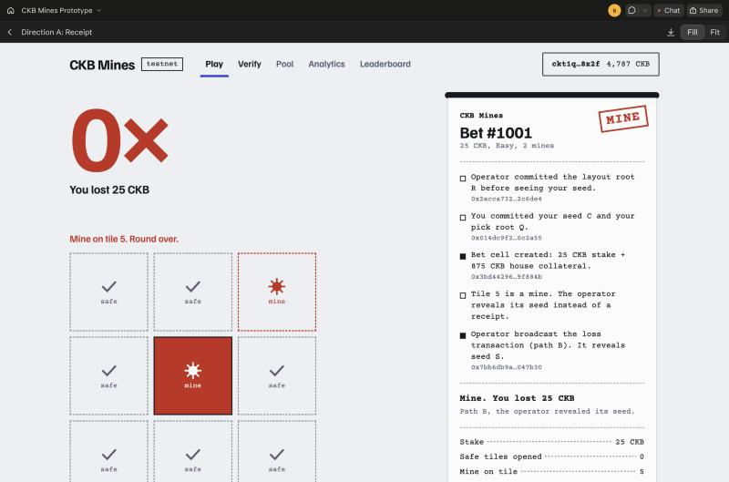

# Week 7 — week ending 2026-11-08

**Name:** Trinh Bach · **Track:** CKBuilders
**Focus:** Choose the application idea (CKB Mines), write the SPEC, and test the idea with a clickable prototype
**Time spent:** [fill in]h

## TL;DR

- **Idea:** CKB Mines, a 3×3 mines game where the operator cannot rig the board, cannot refuse to pay, and cannot trap your money by disappearing. A locked cell holds both sides' money, and a timelock lets you exit alone.
- **Main insight:** the game is a fair bet. No cash-out strategy beats it, so the only real choice is how much risk to take. The operator earns only a 5% fee on profit (about 1% if you stop early, almost 5% if you go deep), while it locks 35× to 125× your stake to cover your best case.
- **Done:** [SPEC](../my-project/SPEC.md) (draft), every number in it re-checked by script, and a [clickable prototype](https://claude.ai/artifact/X5YMiVanhkedzv2qoqzLmZ) you can play now.
- **Next:** Week 8 spike on the two biggest technical risks (script cycles in `ckb-js-vm`, co-signing with CCC), and the review with Neon and DevRel.

## 1. Covered this week

| Item | Status |
|---|---|
| [SPEC: CKB Mines](../my-project/SPEC.md) | Draft done, not yet reviewed by Neon and DevRel |
| [Opportunity Map](https://talk.nervos.org/t/ai-machine-payments-and-fiber-in-2026-an-opportunity-map-for-ckb-and-fiber-developers/10665) and [Spark Program Q2 report](https://talk.nervos.org/t/spark-program-q2-2026-what-the-ecosystem-is-building/10396) | Used as references in the SPEC |
| Game math check ([`project/mines-math.js`](project/mines-math.js)) | Done |
| [Clickable UI prototype](https://claude.ai/artifact/X5YMiVanhkedzv2qoqzLmZ) (mock data) | Done |

## 2. Key learnings

**How the game works**

1. Pick a difficulty (2, 3 or 4 mines hidden among 9 tiles) and a stake.
2. Reveal tiles one at a time. Every safe tile raises the multiplier.
3. Cash out whenever you want, or hit a mine and lose the stake.
4. On a win the operator keeps 5% of your profit.

Example: stake 100 CKB, Easy, 3 safe tiles. Gross payout is 240 CKB (2.4×), profit 140, fee 7, so you receive **233 CKB**.

**Why a custodial version is hard to trust, and what answers each problem**

| Problem with a normal operator | Answer in CKB Mines | Is it CKB-specific? |
|---|---|---|
| Rigged layout | Operator commits to the layout before it sees the player's seed | No, works on any chain |
| Win is not paid | Stake and operator collateral sit in one cell, locked by a custom script, from the first click | Yes: cell model and lock script |
| Operator disappears | After a `since` timelock the player exits alone, using the receipts the operator already gave | Yes: native timelock, no keeper bot |

Two things stay open and the SPEC says so: the operator can still stop answering, and it sees the player's seed before it co-signs the bet ("last look"). I will ask Neon whether the CKB-specific part is enough.

**Insight 1: it is a fair bet, so the only choice is risk**

The multiplier is fair: the chance of surviving `k` tiles times the multiplier equals 1 at every step. So every cash-out rule has the same expected return before the fee. You cannot beat the game by choosing when to stop. Difficulty and cash-out point only set the variance.

**Insight 2: the danger grows fast, and the reward grows faster**

On Easy the first tile is a mine 22% of the time. The last tile before clearing the board is a mine 67% of the time, for a payout that triples (12× to 36×). Every step is the same decision, "cash out or one more tile", so the UI shows the cash-out value and the next-tile risk at every step.

| | Easy | Medium | Hard |
|---|---|---|---|
| Mines | 2 | 3 | 4 |
| Max multiplier (chance to clear) | 36× (1 in 36) | 84× (1 in 84) | 126× (1 in 126) |
| Risk on the first tile | 22% | 33% | 44% |
| Risk on the last tile | 67% | 75% | 80% |
| Operator collateral | 35× stake | 83× stake | 125× stake |
| House edge, first cash-out to deepest run | 1.1% to 4.9% | 1.7% to 4.9% | 2.2% to 5.0% |

**Insight 3: the fee taxes greed**

The fee is only on profit, so the edge is `5% × (1 − 1/M)`. Stopping at the first tile is almost free (about 1%). Going deep costs close to 5%. The operator earns mostly from players who keep going.

**Insight 4: the operator side is capital-heavy and low-yield**

To cover a player's best case, the operator locks 35× to 125× the stake for every bet, and earns less than 5% of the stake. That is roughly 0.02–0.14% of the locked collateral per bet (my calculation, per bet, not annualised, ignoring variance). So the phase-2 liquidity pool is not an obvious yield product. The escrow guarantee is the stronger story, and the LP model needs real analysis before I promise anything.

## 3. Practical progress

- **Wrote the SPEC.** [`my-project/SPEC.md`](../my-project/SPEC.md) covers the rules and payout formula, the trust model, the cells and four script spending paths, a 4-week MVP in two tiers with a checkpoint after Week 9, 9 assumptions to verify in the Week 8 spike, and 6 questions for Neon and DevRel. My honest effort estimate is 55–60 h against a 40 h budget, so a slip cuts scope instead of breaking delivery.

- **Re-checked every number in the SPEC.** I recomputed the multiplier table, the payout example, the collateral and the bet limits from the formulas in integer shannons. They all matched. I added the insights above to section 3 of the SPEC.

  ```text
  node week-07/project/mines-math.js

  SPEC example: stake 100, Easy, k=3
  gross 240.00 profit 140.00 fee 7.00 payout 233.00

  Easy (2 mines)
  max multiplier 36x | P(clear board) = 1/36 | collateral 35x stake | max stake at 2500 cap 71.4
  ```

- **Built a clickable prototype** (mock data, no chain): [open it here](https://claude.ai/artifact/X5YMiVanhkedzv2qoqzLmZ). Press Connect wallet, then Place bet. It covers setup, a round in progress, win, loss, "operator not responding" with the exit countdown, and a Verify page that catches a rigged layout. Each safe tile prints a receipt line, so the evidence the player holds is visible. The demo controls at the bottom of the page simulate an offline or cheating operator.

  

- **The prototype caught a bug in my own display math.** It rounded to whole CKB and showed a 25 CKB bet cashing out at 31 CKB, where the SPEC formula gives 31.79 CKB. I fixed the prototype to compute in shannons and show two decimals, and wrote it into the SPEC as a UI requirement. I also added the five Verify checks and the UI requirements from the prototype.

- No on-chain work this week, so no transaction hash. Testnet work starts in Week 8.

## 4. Blockers / questions

1. **Neon and DevRel have not reviewed the SPEC yet.** The main question is in SPEC section 13: is a dual-funded escrow with timelocked exits enough on the "uses CKB's own features" criterion, when the game logic itself works on any chain?
2. **Effort is 55–60 h against 40 h.** The tiered plan handles it: if a bet cannot be opened and settled cooperatively on testnet by the end of Week 9, I cut the harder script paths and ship the simpler escrow game.
3. **Biggest technical risks, to settle in the Week 8 spike:** whether the two shuffles, the Merkle checks and the hashes fit the cycle limit in `ckb-js-vm`, and whether CCC can build a transaction that the player partially signs and the server co-signs.
