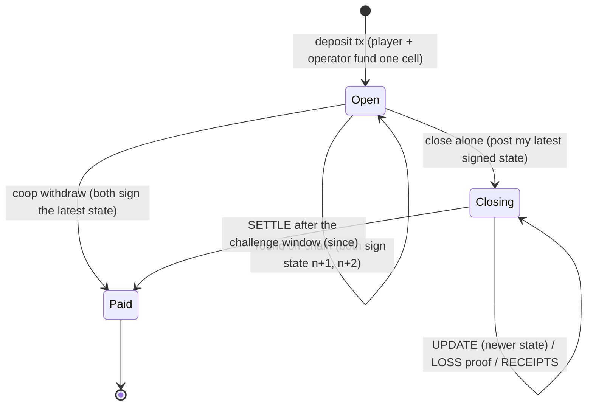
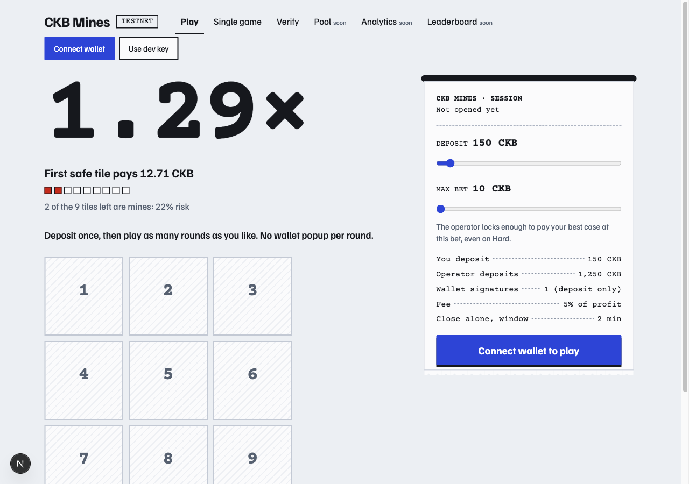

# Week 8 — week ending 2026-11-15

**Name:** Trinh Bach · **Track:** CKBuilders
**Focus:** Build CKB Mines on testnet: the single-game protocol (paths A–D), then multi-round sessions as a state channel on one cell
**Time spent:** [fill in]h

## TL;DR

- **Built:** the whole Phase 1 from the SPEC (two lock scripts on testnet, game server, web app, player SDK) plus multi-round sessions, which were not in the plan. The code is on branch [`ckb-mines-sessions`](https://github.com/Bachhsunkid/ckbuilder/tree/ckb-mines-sessions), commit [`c30e464`](https://github.com/Bachhsunkid/ckbuilder/commit/c30e464), not merged yet.
- **Sessions change the UX:** deposit once (one wallet signature), play rounds off-chain in about 36 ms each, withdraw in one transaction. If the operator disappears, the player can still close and collect alone.
- **Measured on testnet:**
  - Single games: 72/72 settled with exact amounts.
  - Sessions: 60/60 paid out exactly, 304 rounds in total.
  - Drills: 4 kinds passed, 2 not run.
  - Unit and mock tests: 116/116 pass.
- **Not done:** JoyID, public deployment, two session drills (`stale-house`, `killed`), and the Neon / DevRel review of the SPEC.
- **Next (3 weeks to the programme deliverable):** JoyID, a public testnet link, the missing drills, then the video and the Spark draft.

## 1. Covered this week

| Item | Status |
|---|---|
| [SPEC](../my-project/SPEC.md) Phase 1: script paths A–D, Play, Verify | Done, on testnet |
| [ADR 0001: multi-round sessions](../my-project/docs/adr/0001-multi-round-sessions.md) | Accepted and implemented |
| [PLAN](../my-project/PLAN.md), with measured results in sections 2.1 and 2.2 | Updated |
| [Project README](../my-project/README.md): how to run, E2E and drill commands | Updated |
| JoyID co-signing | Not started |

## 2. Key learnings

**A state channel fits in one cell**

The session cell holds the player's deposit P and the operator's deposit H. Each round is a new state that both sides sign off-chain. The chain is touched only to open, to withdraw, or when someone stops cooperating.

- The rule that keeps it honest is simple: a state with a higher number `n` replaces a lower one during the challenge window. Posting an old state does not pay, because the other side answers with a newer one. The `stale-player` drill showed it: the player posted 150 CKB after losing down to 140, and the operator's answer made the payout exactly 140.
- A round in flight needs extra evidence. The player gets a receipt for each safe tile, and the operator holds a loss proof. Either side can post its evidence while the cell is closing. So refusing to sign the round's result gains nothing.
- The CKB-specific part is the relative `since` timelock on the settle path. No keeper bot or block-height oracle is needed.

**Deploying JS source vs bytecode is a real trade-off**

| Session lock | Deploy cost (1 CKB per byte) | Worst-case cycles |
|---|---|---|
| JS source | 29,571 CKB | 62.9M |
| QuickJS bytecode | 37,178 CKB | 21.7M |

- About 57M of the JS cycles go to parsing the script, so the cost is almost fixed and does not grow with input.
- I deployed the JS source because the operator wallet held only about 40k CKB. That leaves about 7M cycles under the default `max_tx_verify_cycles` (70M). Any new rule has to be measured, and bytecode is the fallback. (Assumption: public testnet nodes run the default limit.)

**On CKB, the operator's liquidity is a pool of cells, and cells are the unit of concurrency**

- Each deposit consumes whole operator cells, and one cell can back only one pending transaction. Two problems showed up under load:
  - **Fragmentation:** every session took one large cell and left smaller change, so after a while no single cell could cover a new session. Fix: deposits now merge several cells.
  - **Leaked reservations:** a reservation for a cell the node did not report live yet was kept for 3 hours, which locked live cells. Fix: drop it at once.
- On an account chain this is one balance. On CKB it is an operations problem I had not thought about before this week.

**Smaller things I would have got wrong without testing**

- **Signature byte order:** CKB wants `r||s||recid`, and noble's `recovered` format puts the recovery id first.
- **Timelock clock:** a timestamp `since` is checked against the block median time, which lags the wall clock. Settling right when the window ends gets `Immature`, so the watcher waits an extra 150 s.
- **Following a cell:** to track a session, follow the transaction that spent the cell (`findTransactions` + `getTransaction`). Searching for the live cell misses the case where it was just spent.
- **Check the cause before writing it down:** I first blamed an "opening" bug on CCC's cache and wrote that into a code comment and the ADR. Reading CCC's source showed `getCellLive` does not use the cache. The real cause was a race between the client and the server's watcher. I corrected both.

## 3. Practical progress

- **Deployed two lock scripts to testnet** (both upgradeable through Type ID):
  - `mines-lock`, single games, 26,222 bytes. Code hash `0x61099b4e…26db11`, deploy tx [`0xc44bbde5…856b`](https://testnet.explorer.nervos.org/transaction/0xc44bbde58cf816baf25d8ba863948f2f404e62c7a8333229b81a1297495e856b).
  - `mines-session`, sessions, 29,571 bytes. Code hash `0xded4d77a…ce11c`, deploy tx [`0xb06c0cf4…69ee`](https://testnet.explorer.nervos.org/transaction/0xb06c0cf401ce437fff3c83a2ff356d63f0d9a398bda158cd2c1cde945e1469ee).

- **Built the stack** (npm workspaces under [`my-project/`](../my-project)):
  - `packages/protocol`: shuffle, Merkle receipts, payout, session state rules. The same code runs in ckb-js-vm, Node and the browser.
  - `packages/script`: the two locks.
  - `packages/chain`: CCC transaction builders, plus the `MinesPlayer` and `SessionPlayer` SDKs.
  - `apps/server`: Fastify + Postgres, with a watcher that defends the operator's balance on chain.
  - `apps/web`: Next.js. Play (sessions), Single game, and Verify, which checks every round in the browser.

- **Single games: 72/72 settled with exact amounts** (25 cash-outs, 32 losses, 15 solo exits). The first batch had 5 games that failed to open. The cause was the player's CCC cache offering a cell the server had already spent; the SDK now marks the transactions it signs. Both drills passed: forfeit (path D), and server killed with the player exiting alone (path C).

- **Sessions: 60/60 paid out exactly** with a 120 s challenge window (the production default is 24 h).

  | | Result |
  |---|---|
  | Sessions | 60 opened, 60 OK (41 coop withdraw, 19 closed alone mid-round) |
  | Rounds | 304, median 36 ms, p95 60 ms |
  | Refused at open (HTTP 503, no money moved) | 16, caused by the two house-cell bugs above, both fixed |
  | Statistical reading | 60 in a row puts the failure rate under 5% at 95% confidence (rule of three) |

  "OK" means the player received exactly the balance its rounds add up to, to the shannon. The E2E script computes that balance on its own, not through the SDK, and checks that the server recorded the same close transaction and amount.

  Examples:
  - Coop withdraw after 5 rounds, 197.10 CKB: [`0x8842fb6b…631a`](https://testnet.explorer.nervos.org/transaction/0x8842fb6b9fbf3b692e2822bcc1f2a39b063e97104d57ff39762cc74e3d78631a)
  - Closed alone after 6 rounds, 159.04 CKB: [`0xfece7942…4f79`](https://testnet.explorer.nervos.org/transaction/0xfece79423db690783c84eecf9c3ef2a6634d1c2802cc143c504d97c3302f4f79)

- **Session drills:**
  - Passed:
    - `loss`: the player hit a mine and refused to sign; the operator posted the loss proof.
    - `stale-player`
    - Idle close, three times.
  - Not run: `stale-house` and `killed`, which both need the server stopped by hand. Their player-side code paths did run in the 19 close-alone sessions.

- **Web app by hand** with the dev key: I opened a 150 CKB session with one signature, played two rounds (5/5 checks each), and withdrew 142.71 CKB in one transaction.

  

- **Tests:** 116/116 pass (protocol 28, script 62, chain 22, server 4). Typecheck is clean. The production `next build` does not contain the dev key.

## 4. Blockers / questions

1. **Neon and DevRel review of the SPEC: [status unknown, fill in].** Sessions change the pitch. The CKB-specific part is now a two-party state channel on one cell with a `since` challenge window, which is stronger than the escrow alone. I would like their view on it before the Spark draft.
2. **JoyID co-signing is untested.** All runs used private-key signers. Sessions need one wallet signature per deposit and per withdraw, but closing alone also signs states with a session key held in the browser. I need to check that JoyID can sign the deposit and the coop withdraw that CCC builds.
3. **Cycle headroom is about 7M** with the JS-source session lock. Any new rule means re-measuring, or redeploying as bytecode for about 37k CKB of testnet funds.
4. **Not covered yet:** the production 24 h challenge window, more than 3 concurrent players, and the two drills above. The plan for the next 3 weeks is in [PLAN](../my-project/PLAN.md) section 2.
