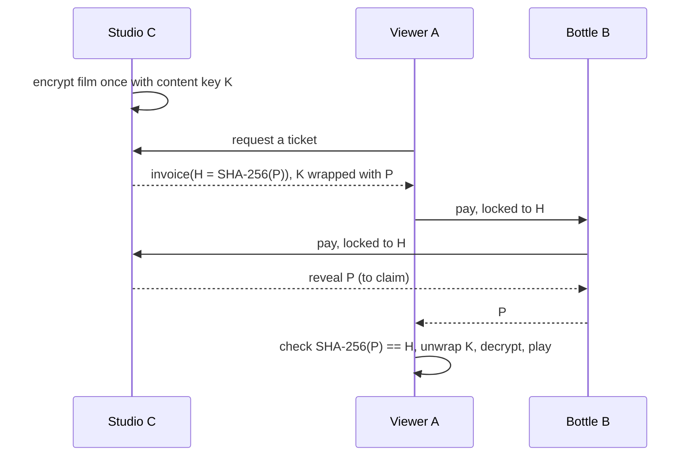
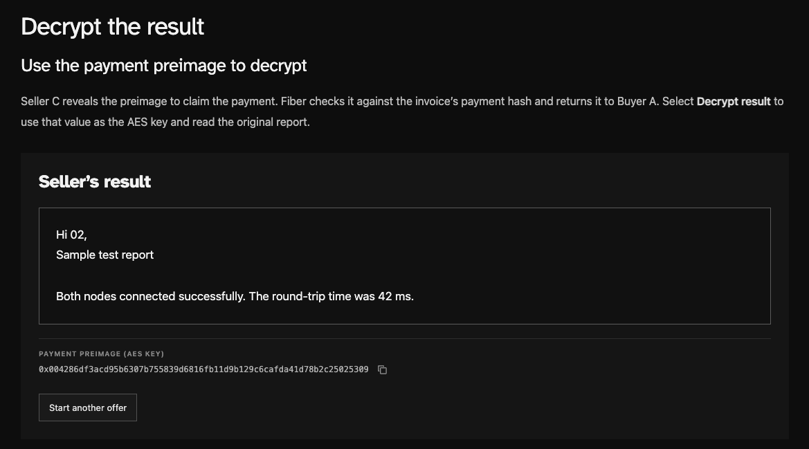
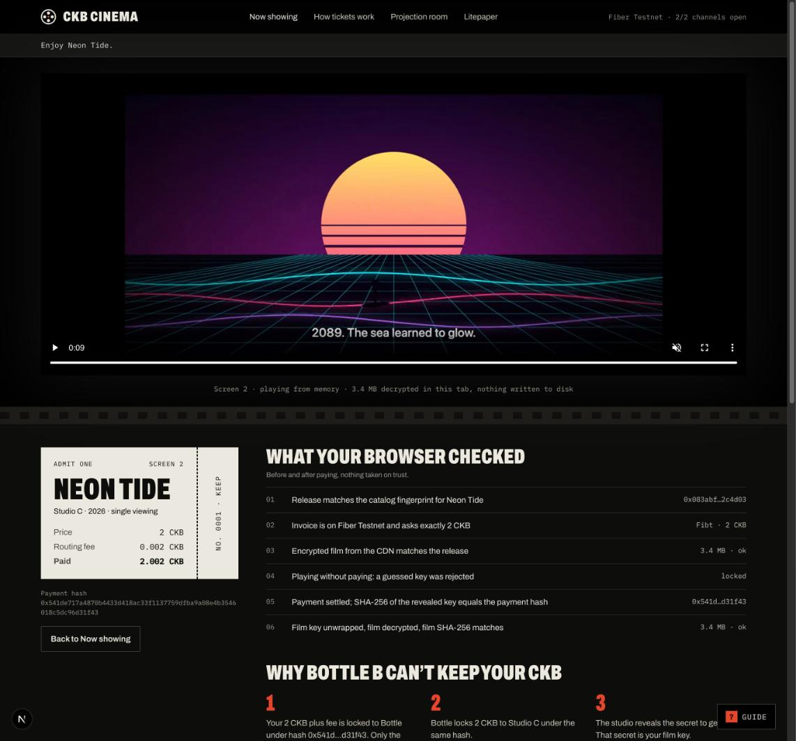
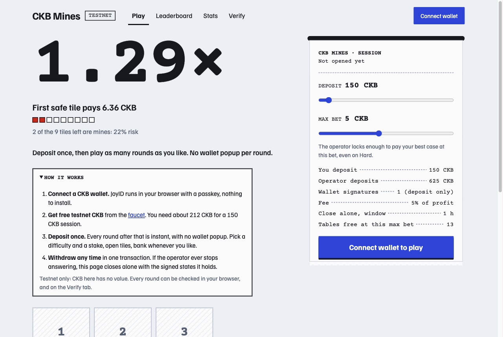
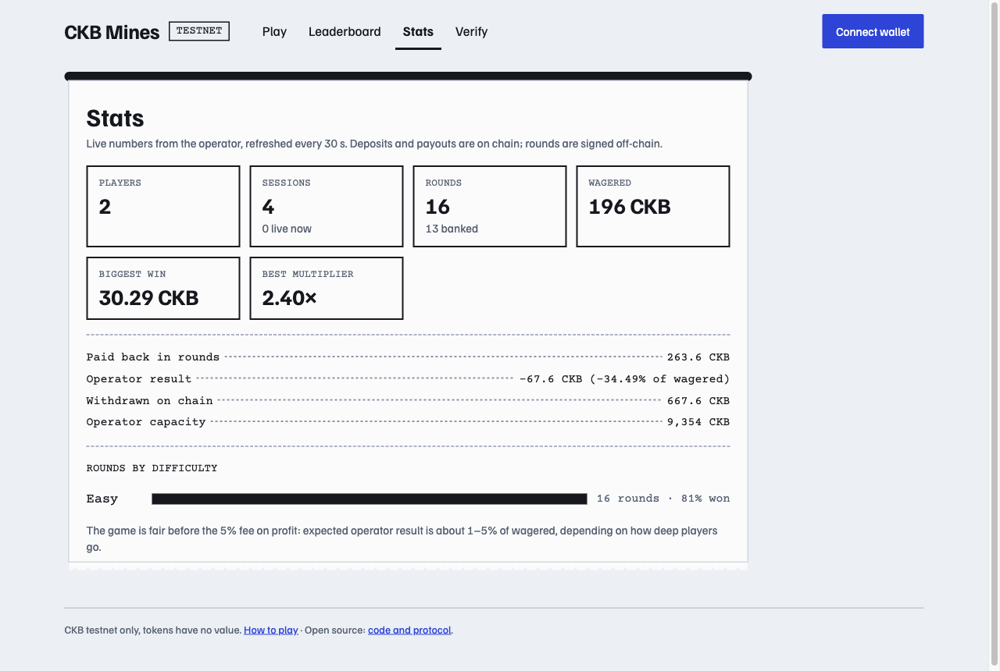

# Week 9 — week ending 2026-11-22

**Name:** Trinh Bach · **Track:** CKBuilders
**Focus:** Build on CKB Campaign #8 (Fiber pay-to-unlock, Basic and Advanced quests), then CKB Mines ready for a public testnet playtest
**Time spent:** [fill in]h

## TL;DR

- **Campaign #8, both quests done.**
  - Quest 1 (Basic): the interactive tutorial *Unlock Encrypted Data with a Fiber Payment*, with screenshots and a reflection.
  - Quest 2 (Advanced): **CKB Cinema**, a pay-per-view film site on Fiber Testnet. It is live at https://ckb-cinema.vercel.app with 18 tests and a litepaper.
- **CKB Mines is public on testnet:** https://ckb-mines.vercel.app. The API runs on Render with Neon Postgres, and the web app runs on Vercel, all on free tiers.
- **Prepared for strangers:** rate limits, one live session per wallet, a lower max bet, a phone action bar, opening progress, a first-visit guide, readable errors, plus Leaderboard and Stats tabs.
- **Measured on the public deployment:** 4/4 sessions paid out exactly (16 rounds, median 1.17 s per round). Unit and mock tests pass 116/116.
- **Not done:** a JoyID run, the two remaining session drills, and the Neon / DevRel review of the SPEC. The launch code is on branch [`ckb-mines-launch`](https://github.com/Bachhsunkid/ckbuilder/tree/ckb-mines-launch), not merged into `main` yet.

## 1. Covered this week

| Item | Status |
|---|---|
| [Unlock Encrypted Data with a Fiber Payment](https://www.fiber.world/docs/build/encrypted-data-payment) (interactive tutorial) | Done: Campaign #8 Quest 1 |
| Starter project of the same tutorial (Fiber v0.10.1, `@fiber-pay/sdk` 0.3.1) | Extended into CKB Cinema: Campaign #8 Quest 2 |
| CKB Mines public playtest: hardening, UX, Leaderboard, Stats, deploy | Done, live on testnet |
| [Player guide](../my-project/docs/PLAY.md) and [launch announcement](../my-project/docs/launch-announcement.md) | Written |
| PR #1 (single games + sessions) merged into `main` | Done (2026-11-15) |
| JoyID co-signing | Started, not finished |

## 2. Key learnings

**In a Fiber pay-to-unlock, the payment is the key delivery**

- The seller uses one secret twice: as the preimage of the Fiber invoice and as the AES key. The seller can only claim the payment by revealing the preimage, and revealing the preimage hands the buyer the key. Nobody has to trust anyone to "send the key after payment".
- Before paying, the buyer can check everything except the key: the invoice network, amount and payment hash, and the ciphertext hash. In the tutorial, decrypting without the key was rejected. After paying 1 CKB, `SHA-256(preimage)` equalled the receipt's payment hash, and the text decrypted.
- Bottle B (the routing node) cannot keep the CKB. Its incoming and outgoing payments are locked to the same payment hash, so B gets paid only once Studio C reveals the preimage downstream, and by then the buyer gets it too. This was the one thing I missed in the tutorial, so CKB Cinema explains it on the checkout using the payment's real hash.

**One secret per buyer does not scale to large files; envelope encryption does**

- The tutorial encrypts one result for one buyer. A film is large and sold many times, so CKB Cinema encrypts each film **once** with a content key and puts the ciphertext on a CDN. Each purchase gets a fresh preimage that only **wraps the content key**. The offer stays a few hundred bytes whatever the film's size.
- The wrap is bound to film, film hash, price and payment hash (as AES-GCM additional data), and the film description is the additional data of the film itself. A relabelled file or a ticket for another film fails to decrypt instead of playing the wrong thing.
- Every purchase has its own payment hash, yet all of them open the same encrypted file. In my experience this is the part that differs most from a classic DRM licence server: no server holds a per-user key.

**On CKB Mines, the max bet decides how many people can play at once**

- The operator locks enough collateral to cover the player's best possible win: 125 × max bet (Hard has C(9,4) − 1 = 125 as its top multiplier), and the deposit also reserves a 61 CKB cell. At a 10 CKB max bet a session takes about 1,311 CKB. The operator wallet holds about 9,400 CKB, so only about 7 sessions could run at once.
- I lowered the default max bet to 5 CKB, capped it at 10, and show "tables free at this max bet" on the setup panel (13 at 5 CKB). On an account chain the operator's liquidity is one balance. On CKB it is a set of cells, and this number is what a new player hits first.
- One live session per wallet stops one tester from holding several tables.

**Free hosting changes the UX, not just the cost**

- Render's free tier stops the service after 15 minutes idle, and the first request after that takes up to a minute. The first public load showed "Failed to fetch". The page now retries the server config with backoff and says it is waking the server. A saved session stays usable during the wait. The server also pings its own health URL every 10 minutes so it rarely sleeps during the playtest.
- Behind Render's proxy every request comes from the proxy's IP. Per-IP rate limits only work with `trustProxy` on, otherwise all players share one quota.
- A round takes about 1.17 s on the public deployment against 36 ms locally. Each round is a few HTTP round trips plus database writes, and the database is in another provider's network. (Assumption: most of the gap is network latency between Render and Neon, not measured.) It is still well under a wallet popup.

## 3. Practical progress

### Campaign #8, Quest 1 (Basic): pay to unlock a report

- Ran the interactive tutorial on CKB Testnet: two channels to Bottle B reached `CHANNEL_READY`, an encrypted offer was rejected without the key, a 1 CKB payment returned the preimage, and the report decrypted to the seller's text.
- The receipt's payment hash `0x94b64644…ee4c5a` equals the SHA-256 of the revealed preimage `0x004286df…025309`.
- Screenshots and reflection: [docs/quest-1](../campaign/quest-2/ckb-cinema/docs/quest-1/README.md).

  

### Campaign #8, Quest 2 (Advanced): CKB Cinema

- **What it is:** watch any trailer for free, pay 1 to 5 CKB over Fiber to unlock one full film. There is no subscription and no account. This is the use case from my Quest 1 reflection: occasional viewers, for whom pay-as-you-go beats a subscription.
- **Changes from the starter:**
  - Film catalog with free trailers and in-browser playback.
  - Envelope encryption.
  - Ticket binding, SHA-256 checks on master, ciphertext and decrypted film.
  - The buyer rejects an invoice that does not ask exactly the listed price.
  - Retry for the "waiting for peer Init" race when opening a channel.
  - A cinema-style UI with a numbered list of every check, a "Why Bottle B can't keep your CKB" explainer, a first-visit guide, and an on-site litepaper.
- **Media are generated procedurally**, so there is no copyright issue.
- **Tests:** 18 (the 9 starter payment tests, plus price mismatch, envelope, binding, tamper and release parsing).
- **Demo:** 9 screenshots of one 2 CKB purchase of *Neon Tide* (payment hash `0x541de717…d31f43`, 0.002 CKB routing fee): [docs/demo](../campaign/quest-2/ckb-cinema/docs/demo/README.md).
- Links: [live demo](https://ckb-cinema.vercel.app) · [litepaper](https://ckb-cinema.vercel.app/litepaper) · [code](../campaign/quest-2/ckb-cinema) · [submission](../campaign/quest-2/SUBMISSION.md) · commits [`becf22d`](https://github.com/Bachhsunkid/ckbuilder/commit/becf22d), [`18464e1`](https://github.com/Bachhsunkid/ckbuilder/commit/18464e1)

  

### CKB Mines: public testnet playtest

- **Server:**
  - Rate limits: 600 requests per minute per IP, and 6 session opens per minute.
  - One live session per wallet. Leftovers that never opened are expired and their operator cells released.
  - Session min stake 1 CKB.
  - Playtest settings: 1 h challenge window, 15 min idle close, 10 CKB max bet.
  - New endpoints `/api/stats` and `/api/leaderboard`, cached for 15 s.
- **Web:**
  - Phone action bar with the next action, balance and risk.
  - The four opening steps shown with the deposit transaction link.
  - First-visit guide; faucet help with "copy my address".
  - Readable errors for wallet cancel, network, rate limit, no free table and low balance.
  - Wallet menu, past sessions, Leaderboard and Stats tabs.
  - Verify now checks session rounds, including that the deposit on chain uses the session's lock.
  - Share preview and icon. Single game and Pool are hidden from the menu.
- **Deploy:**
  - `Dockerfile` and a Render Blueprint ([`render.yaml`](../render.yaml)) for the API.
  - Neon Postgres in Singapore.
  - Vercel for the web app.
  - Steps are in the [README](../my-project/README.md). Secrets were entered by me in the providers' dashboards, never committed.
- **Results:**

  | Check | Result |
  |---|---|
  | Unit and mock tests | 116/116 pass, typecheck clean |
  | Local E2E with the new limits | 8/8 sessions OK (3 coop withdraw, 5 closed alone) |
  | Public E2E | 4/4 coop withdraw OK, 16 rounds, median 1,167 ms per round |
  | By hand, desktop and 375 px phone, real testnet sessions | Open → round → bank → withdraw; Verify 6/6 PASS including the on-chain check |
  | Network in steady state | One `/api/stats` call every 30 s, no request loop |

  "OK" means the same as in week 8: the player received exactly the balance its rounds add up to, to the shannon.

  

  

- Commits on `ckb-mines-launch`: [`1557e31`](https://github.com/Bachhsunkid/ckbuilder/commit/1557e31), [`dabff7f`](https://github.com/Bachhsunkid/ckbuilder/commit/dabff7f), [`3d683f9`](https://github.com/Bachhsunkid/ckbuilder/commit/3d683f9).

## 4. Blockers / questions

1. **JoyID is still untested end to end.** I started the JoyID connect on the public site, but have not yet signed a deposit and a withdraw with it. The launch announcement says JoyID works, so this run has to pass before I share the link.
